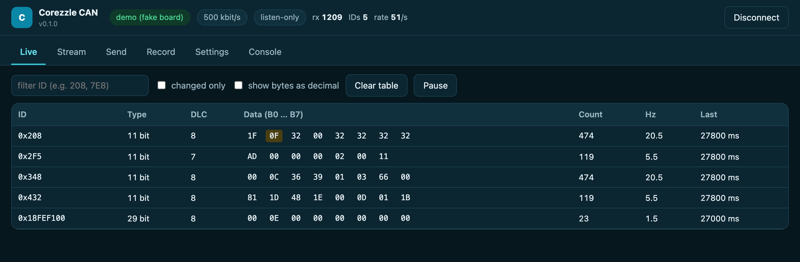
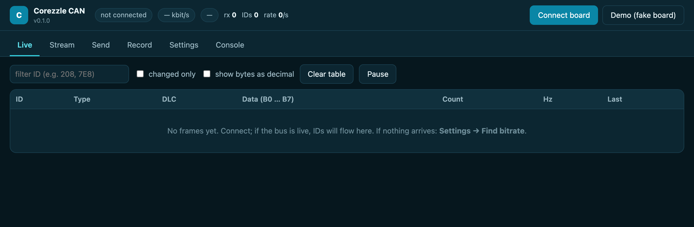
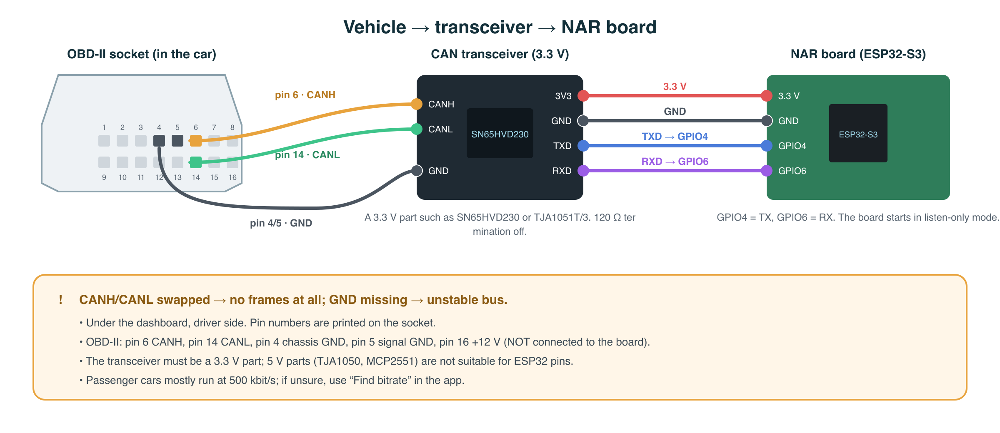
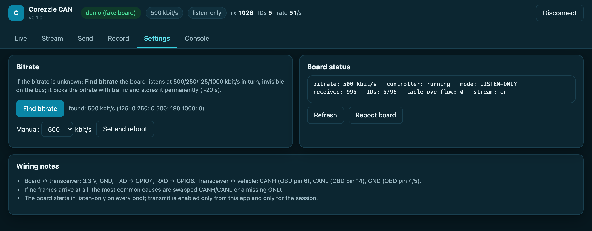
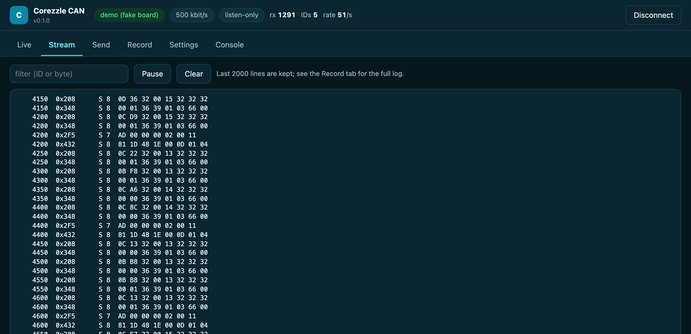
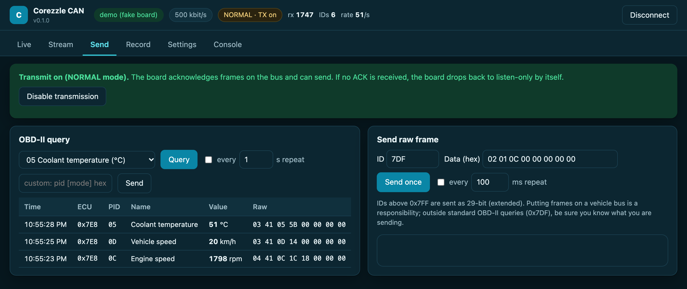
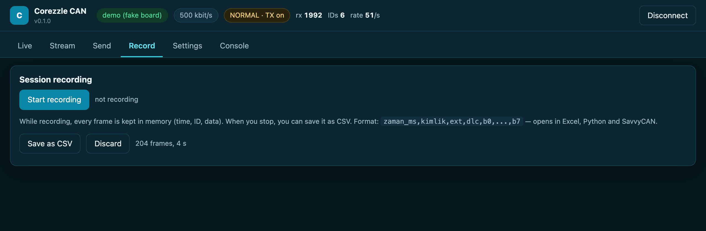
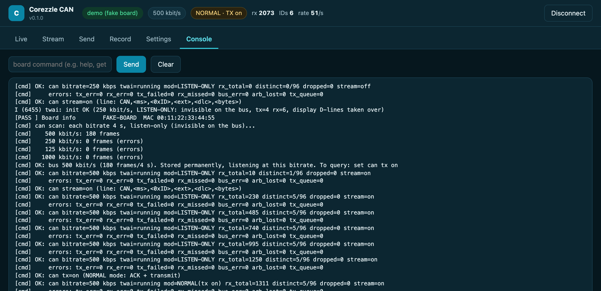

# Corezzle CAN — Wiki dökümanı (tam metin)

Bu dosya `docs/panel-icerik/` altındaki 14 bölümün (TR) ve `en/` altındaki İngilizce karşılıklarının **tek dosyada birleştirilmiş** halidir; gözden geçirme için. Panele girilecek olan parça dosyalardır; bu dosya elle düzenlenmez, `node docs/wiki-html/birlestir.mjs` ile yeniden üretilir. Üretim: 2026-11-20.

Görseller: `gorseller/` (ekran görüntüleri demo modundan, arayüz metinleri İngilizce; bağlantı şeması İngilizce).

## İçindekiler

**Türkçe**

1. Genel bakış
2. Bu uygulama ne yapar?
3. Temel kavramlar
4. Hızlı başlangıç
5. Donanım ve bağlantılar
6. Karta bağlanma ve hat hızı
7. Canlı ve Akış
8. Gönder: OBD-II ve güvenlik kilidi
9. Kayıt
10. Konsol ve kart komutları
11. Güvenlik modeli ve sahada öğrenilenler
12. Demo modu
13. Sorun giderme
14. Kaynak kod, testler ve lisans

**English**

1. Overview
2. What does this app do?
3. Core concepts
4. Quick start
5. Hardware and wiring
6. Connecting and bitrate
7. Live and Stream
8. Send: OBD-II and the safety lock
9. Recording
10. Console and board commands
11. Safety model and field lessons
12. Demo mode
13. Troubleshooting
14. Source code, tests and licence

---

# Türkçe

## 1. Genel bakış

Corezzle CAN, NAR kartını aracın veri yoluna bağlayıp **o hatta ne konuşulduğunu bilgisayar ekranında gösteren** masaüstü uygulamasıdır. Kartın küçük bir eki (CAN alıcı-verici) aracın OBD-II soketine takılır; uygulama kartla USB üzerinden konuşur, gelen mesajları canlı tabloda gösterir, kaydeder, istenirse araca standart sorular sorar (devir, hız, sıcaklık, yakıt).



<div style="font-size:12.5px;color:inherit;opacity:.72;text-align:center;margin:-6px 0 14px"><em>Canlı sekmesi. Her satır bir mesaj kimliği; değişen baytlar sarı yanar, sağda saniyedeki tekrar sayısı. (Ekran görüntüleri İngilizce arayüzden; düğme ve sütun adlarının Türkçe karşılıkları metinde.)</em></div>

<div style="display:flex;gap:10px;flex-wrap:wrap;margin:18px 0"><div style="flex:1 1 120px;max-width:190px;background:rgba(128,128,128,.10);border:1px solid rgba(128,128,128,.28);border-radius:12px;padding:16px 10px;text-align:center"><div style="font-size:24px;font-weight:800;color:#12A0AD;line-height:1.1">6</div><div style="font-size:12.5px;color:inherit;opacity:.72;margin-top:6px;line-height:1.35">sekme: Canlı, Akış, Gönder, Kayıt, Ayarlar, Konsol</div></div><div style="flex:1 1 120px;max-width:190px;background:rgba(128,128,128,.10);border:1px solid rgba(128,128,128,.28);border-radius:12px;padding:16px 10px;text-align:center"><div style="font-size:24px;font-weight:800;color:#12A0AD;line-height:1.1">4</div><div style="font-size:12.5px;color:inherit;opacity:.72;margin-top:6px;line-height:1.35">hat hızı otomatik taranır (125/250/500/1000)</div></div><div style="flex:1 1 120px;max-width:190px;background:rgba(128,128,128,.10);border:1px solid rgba(128,128,128,.28);border-radius:12px;padding:16px 10px;text-align:center"><div style="font-size:24px;font-weight:800;color:#12A0AD;line-height:1.1">17</div><div style="font-size:12.5px;color:inherit;opacity:.72;margin-top:6px;line-height:1.35">hazır OBD-II sorgusu, değeri çözülmüş</div></div><div style="flex:1 1 120px;max-width:190px;background:rgba(128,128,128,.10);border:1px solid rgba(128,128,128,.28);border-radius:12px;padding:16px 10px;text-align:center"><div style="font-size:24px;font-weight:800;color:#12A0AD;line-height:1.1">0</div><div style="font-size:12.5px;color:inherit;opacity:.72;margin-top:6px;line-height:1.35">kart hattı hisseder: varsayılan listen-only</div></div><div style="flex:1 1 120px;max-width:190px;background:rgba(128,128,128,.10);border:1px solid rgba(128,128,128,.28);border-radius:12px;padding:16px 10px;text-align:center"><div style="font-size:24px;font-weight:800;color:#12A0AD;line-height:1.1">3</div><div style="font-size:12.5px;color:inherit;opacity:.72;margin-top:6px;line-height:1.35">işletim sistemi: macOS, Windows, Linux</div></div></div>

Bu belge hem uygulamayı hiç görmemiş biri için (ne yapar, nasıl bağlanır, neye dikkat edilir) hem de araçta ölçüm yapacak teknisyen için (hız bulma, OBD sorgusu, kayıt, sorun giderme) yazıldı. Teknik terimler ilk geçtikleri yerde açıklanıyor; **Temel kavramlar** bölümü kısa bir sözlüktür.

<div style="display:grid;grid-template-columns:repeat(auto-fit,minmax(250px,1fr));gap:14px;margin:18px 0"><div style="background:rgba(128,128,128,.08);border:1px solid rgba(128,128,128,.24);border-radius:14px;padding:20px"><div style="font-size:11.5px;font-weight:800;letter-spacing:1.2px;text-transform:uppercase;color:#12A0AD">Güvenlik</div><div style="font-size:17px;font-weight:700;margin:8px 0 6px;color:inherit">Hat kartı hissetmez</div><div style="font-size:14px;color:inherit;opacity:.72;line-height:1.5">Kart her açılışta yalnız dinler: onay (ACK) vermez, hata üretmez. Gönderim yalnız uygulamadan, o oturum için ve hat hızı doğrulanmışsa açılır.</div></div><div style="background:rgba(128,128,128,.08);border:1px solid rgba(128,128,128,.24);border-radius:14px;padding:20px"><div style="font-size:11.5px;font-weight:800;letter-spacing:1.2px;text-transform:uppercase;color:#12A0AD">Teşhis</div><div style="font-size:17px;font-weight:700;margin:8px 0 6px;color:inherit">Hızı kendisi bulur</div><div style="font-size:14px;color:inherit;opacity:.72;line-height:1.5">Araçtaki hat hızını bilmeniz gerekmez. Kart dört hızı sırayla, hatta görünmeden dinler; mesaj gelen hızı seçip kalıcı yazar.</div></div><div style="background:rgba(128,128,128,.08);border:1px solid rgba(128,128,128,.24);border-radius:14px;padding:20px"><div style="font-size:11.5px;font-weight:800;letter-spacing:1.2px;text-transform:uppercase;color:#12A0AD">Veri</div><div style="font-size:17px;font-weight:700;margin:8px 0 6px;color:inherit">Ham mesaj + çözülmüş OBD</div><div style="font-size:14px;color:inherit;opacity:.72;line-height:1.5">Canlı tablo ham baytları gösterir; OBD-II cevapları ise motor devri, hız, sıcaklık gibi okunur değerlere çevrilir.</div></div><div style="background:rgba(128,128,128,.08);border:1px solid rgba(128,128,128,.24);border-radius:14px;padding:20px"><div style="font-size:11.5px;font-weight:800;letter-spacing:1.2px;text-transform:uppercase;color:#12A0AD">Donanımsız</div><div style="font-size:17px;font-weight:700;margin:8px 0 6px;color:inherit">Demo modu</div><div style="font-size:14px;color:inherit;opacity:.72;line-height:1.5">Kart ve araç yokken uygulamanın tamamı yazılım içindeki sahte bir kartla denenebilir; eğitim ve tanıtım için.</div></div></div>

<div style="border-left:4px solid #12A0AD;background:rgba(18,160,173,.10);border-radius:0 10px 10px 0;padding:14px 18px;margin:18px 0"><div style="font-weight:800;margin-bottom:6px;color:inherit">Kart tarafı</div><div style="line-height:1.6;color:inherit">Bu uygulama tek başına çalışmaz; karşısında NarRTOS Wear yazılımı yüklü bir NAR kartı (ESP32-S3) ve bir CAN alıcı-verici olmalı. Kart yazılımı açık kaynaktır: <a href="https://github.com/corezzle/NarRTOS-Wear">NarRTOS Wear</a>. Uygulamanın kaynak kodu da açıktır: <a href="https://github.com/corezzle/corezzle-can">corezzle-can</a> (Apache-2.0).</div></div>

---

## 2. Bu uygulama ne yapar?

Modern bir araçta onlarca küçük bilgisayar var: motor kontrol ünitesi, fren sistemi, gösterge paneli, kapı modülleri. Hepsi iki telden oluşan ortak bir hat üzerinden sürekli konuşur. Bu hatta **CAN** denir. Araç çalışırken hatta saniyede binlerce kısa mesaj akar: motor devri, hız, pedal konumu, sıcaklıklar, uyarılar.

Corezzle CAN bu konuşmayı dinlemenizi sağlar. Araç tarafında bir NAR kartı ve küçük bir alıcı-verici, bilgisayar tarafında bu uygulama. Kart mesajları olduğu gibi (ham) iletir; anlamlandırma ve gösterim bilgisayardadır.

## Üç kullanım biçimi

| Kim | Ne için | Hangi sekmeler |
|---|---|---|
| Geliştirici | NarRTOS'un CAN tarafını masada ve araçta doğrulamak, hangi kimliklerin aktığını görmek | Canlı, Akış, Konsol |
| Saha teknisyeni | Araçta hat hızını bulmak, bağlantının doğru olduğunu kanıtlamak, motor verisini sorgulamak | Ayarlar, Gönder |
| Veri toplayan | Bir sürüşün ham CAN kaydını alıp sonradan incelemek (tablo programı, Python) | Kayıt |

## Sekmeler

| Sekme | İşlev |
|---|---|
| **Canlı** | Kimlik başına son mesaj; değişen baytlar vurgulu; sayı, saniyedeki mesaj, son görülme; kimliğe göre süzme |
| **Akış** | Ham satır akışı (son 2000 satır), duraklat, süz |
| **Gönder** | Gönderimi aç/kapat (güvenlik kilidi), hazır OBD-II sorguları ve çözülmüş cevap, ham frame gönderme, tekrarlı gönderim |
| **Kayıt** | Oturumu belleğe al, CSV olarak kaydet |
| **Ayarlar** | Hat hızını otomatik bul, elle hız, kart durumu ve hata sayaçları, kartı yeniden başlat |
| **Konsol** | Karta serbest komut yazma; kartın bütün cevapları burada akar |

## Ne yapmaz

- Mesajların **anlamını** çözmez. 0x208 kimliğinin hangi araçta ne anlama geldiği üreticiye özeldir; uygulama ham baytları gösterir. Çözülen tek şey standart OBD-II cevaplarıdır.
- Arıza kodu silmez, ayar yazmaz, aracın modüllerini programlamaz. Standart OBD-II sorgusu dışında hatta mesaj basmak kullanıcının sorumluluğundadır ve uygulama bunu bilerek zorlaştırır.
- Sunucuya veri göndermez. NarRTOS'un telemetri servisi CAN tablosunu kendi raporuyla sunucuya zaten iletir; bu uygulama yerel bir izleme aracıdır.

<div style="border-left:4px solid #12A0AD;background:rgba(18,160,173,.10);border-radius:0 10px 10px 0;padding:14px 18px;margin:18px 0"><div style="font-weight:800;margin-bottom:6px;color:inherit">NarRTOS Drive ile ilişkisi</div><div style="line-height:1.6;color:inherit">Corezzle’ın ekransız araç takip ürünü NarRTOS Drive de aynı CAN yaklaşımını kullanır: cihaz ham mesajı iletir, çözüm sunucudadır. Corezzle CAN o ürünün sahadaki gözü gibi düşünülebilir; kart tarafındaki <code>can stream</code> komutunu tanıyan her NarRTOS derlemesiyle çalışır.</div></div>

---

## 3. Temel kavramlar

Belgede geçen terimlerin kısa karşılıkları. Zaten biliyorsanız atlayın.

| Terim | Anlamı |
|---|---|
| **CAN** (Controller Area Network) | Araç içindeki modüllerin ortak konuştuğu iki telli hat. Mesajlar küçüktür (en çok 8 bayt), herkes her mesajı duyar |
| **Frame** (mesaj) | Hattaki bir paket: bir kimlik + 0–8 bayt veri. Belgede "mesaj" ve "frame" aynı şeydir |
| **Kimlik** (ID) | Mesajın türünü söyleyen numara; 11 bit (0x000–0x7FF) ya da 29 bit (genişletilmiş). Hangi kimliğin ne olduğu üreticiye özeldir |
| **DLC** | Mesajdaki veri bayt sayısı (0–8) |
| **Hat hızı** (bitrate) | Hattın konuşma hızı: 125, 250, 500 ya da 1000 kbit/s. Yanlış hızda dinleyen hiçbir şey anlamaz. Binek araçlarda çoğunlukla 500, kamyon/J1939'da 250 |
| **CANH / CANL** | Hattın iki teli. Ters bağlanırsa hiçbir mesaj çözülmez |
| **Transceiver** (alıcı-verici) | Hattın elektriksel seviyesini işlemcinin 3,3 V sinyaline çeviren küçük çip. Olmadan kart hatta bağlanamaz |
| **OBD-II** | Her binek araçta bulunan 16 pinli teşhis soketi ve üzerinde konuşulan standart soru-cevap dili (motor devri, hız, arıza kodları) |
| **PID** | OBD-II'de sorulan "soru numarası": 0C motor devri, 0D araç hızı, 05 soğutma sıvısı sıcaklığı gibi |
| **ECU** | Araçtaki bir kontrol ünitesi. OBD sorusuna 0x7E8 kimliğiyle cevap veren genellikle motor ünitesidir |
| **ACK** (onay) | CAN'de her mesajı duyan düğümler hatta tek bitlik bir onay basar. Onay gelmeyen gönderici hata üretir ve tekrar dener |
| **Listen-only** (yalnız dinleme) | Kartın onay bile basmadığı mod. Hat kartın varlığını hiç hissetmez; araç için en güvenli durum |
| **TEC** | Gönderici hata sayacı. 128'i geçince CAN denetleyicisi "hata-pasif" olur; kart bu eşikte gönderimi kendisi kapatır |
| **NVS** | Kartın kalıcı ayar belleği. Bulunan hat hızı buraya yazılır, yeniden başlatınca korunur |

---

## 4. Hızlı başlangıç

Uygulamayı ilk kez kuran biri için 10 dakikalık yol. Donanım yoksa 4. adımda **Demo** ile devam edilir; gerçek kart ve araç adımları sonraki bölümlerde.

<div style="border-left:4px solid #12A0AD;background:rgba(18,160,173,.10);border-radius:0 10px 10px 0;padding:14px 18px;margin:18px 0"><div style="font-weight:800;margin-bottom:6px;color:inherit">Gerekenler</div><div style="line-height:1.6;color:inherit">Windows, macOS ya da Linux bilgisayar. Kart için: NarRTOS <code>nar_esp32s3</code> derlemesi yüklü NAR kartı (Konsol’da <code>help</code> yazınca listede <code>can stream</code> görünmeli), bir 3,3 V CAN alıcı-verici ve <strong>veri taşıyan</strong> bir USB kablosu. Node.js ve Git yalnız kaynak koddan çalıştıracaklar için gerekir.</div></div>

## 1. Uygulamayı kurun

İki yol var. Yalnız kullanacaksanız hazır paketi alın; kodu değiştirecekseniz kaynak koddan çalıştırın.

### Hazır paket

İndirme sayfası: <a href="https://github.com/corezzle/corezzle-can/releases/latest">github.com/corezzle/corezzle-can/releases</a>. İşletim sisteminize uygun dosyayı alın:

- **Windows:** `Corezzle-CAN-Setup.exe` dosyasını çalıştırın. Windows "Windows protected your PC" (bilgisayarınız korundu) penceresi gösterirse *More info* → *Run anyway* deyin; uygulama yeni olduğu için bu uyarı çıkar. Kurulum birkaç saniyede kendiliğinden tamamlanır ve uygulama açılır; sonraki açılışlar Başlat menüsünden.

- **macOS:** İki dosya var: Apple Silicon (M1 ve sonrası) için `Corezzle-CAN-AppleSilicon.dmg`, Intel işlemcili Mac için `Corezzle-CAN-Intel.dmg`. Hangisi olduğunu  menüsü → *Bu Mac Hakkında* gösterir ("Çip: Apple M…" ya da "İşlemci: Intel…"). İnen dosyayı açın, Corezzle CAN simgesini Uygulamalar (Applications) klasörüne sürükleyin. İlk açılışta "Apple cannot check it for malicious software" uyarısı çıkarsa uygulamaya sağ tıklayıp *Aç* deyin. Yeni macOS sürümlerinde bu yetmezse *Sistem Ayarları → Gizlilik ve Güvenlik* sayfasının altındaki *Yine de Aç* düğmesine basın. Bir kez yeter.

- **Linux:** `corezzle-can-linux-x64-<sürüm>.zip` dosyasını bir klasöre açın, içindeki `corezzle-can` dosyasını çalıştırın. Seri porta erişim için kullanıcınız `dialout` grubunda olmalı: `sudo usermod -aG dialout $USER`, sonra oturumu kapatıp açın.

### Kaynak koddan

Bilgisayarda Node.js 18 ya da üstü ve Git kurulu olmalı:

```
git clone https://github.com/corezzle/corezzle-can.git
cd corezzle-can
npm install
npm start
```

Son komut birkaç saniye sonra uygulama penceresini açar; sonraki seferlerde yalnız `npm start` yeter.

## 2. Açılış

Hangi yolla kurulmuş olursa olsun uygulama aynı ekranla açılır: üstte durum rozetleri, sağda **Karta bağlan** ve **Demo (sahte kart)**.



<div style="font-size:12.5px;color:inherit;opacity:.72;text-align:center;margin:-6px 0 14px"><em>Açılış. Üstte durum rozetleri (bağlantı, hız, mod), sağda Karta bağlan ve Demo.</em></div>

## 3. Kartla

Kartı USB ile takın, **Karta bağlan** deyin, listeden ESP32-S3 portunu seçin (macOS'ta `usbmodem…`, Windows'ta `COM…`, Linux'ta `ttyACM…`). Kart yeni takıldıysa açılış 30 saniye sürebilir; hazır olunca üstte hız ve mod görünür.

## 4. Kartsız

**Demo (sahte kart)** deyin. Yazılım içinde kartı taklit eden bir hat açılır; aşağıdaki adımların hepsi aynı çalışır.

## 5. Hızı bulun

Ayarlar → **Hızı bul**. Yaklaşık 20 saniye sürer; sonuç "bulundu: 500 kbit/s" gibi görünür ve kalıcı yazılır.

## 6. İzleyin

Canlı sekmesine dönün. Mesajlar akıyorsa bağlantı doğrudur.

## 7. Sorun

Gönder → **Gönderimi aç** → listeden *Motor devri* → **Sorgula**. Tabloya motor ünitesinin cevabı çözülmüş değerle düşer.

<div style="border-left:4px solid #D9922F;background:rgba(217,146,47,.12);border-radius:0 10px 10px 0;padding:14px 18px;margin:18px 0"><div style="font-weight:800;margin-bottom:6px;color:inherit">Araçta ilk denemede</div><div style="line-height:1.6;color:inherit">Kontak açık ya da motor çalışır olmalı; çoğu araç kontak kapalıyken hatta hiçbir şey konuşmaz. Hiç mesaj gelmiyorsa önce <strong>CANH/CANL ters mi</strong> ve <strong>GND bağlı mı</strong> diye bakın; bu ikisi ilk denemelerde en sık karşılaşılan sebeptir.</div></div>

## Güncelleme

Uygulama kendini güncellemez. Yeni sürüm çıkınca aynı indirme sayfasından yeni paketi alıp üstüne kurarsınız; kayıtlarınız silinmez. Kaynak koddan çalıştıranlar `git pull` ve `npm install` yapar.

---

## 5. Donanım ve bağlantılar

**Kısaca:** araç soketinden iki tel ve toprak alıcı-vericiye, alıcı-vericiden dört tel karta. Toplam yedi bağlantı.



<div style="font-size:12.5px;color:inherit;opacity:.72;text-align:center;margin:-6px 0 14px"><em>Araç → alıcı-verici → kart. Renkler teller: CANH turuncu, CANL yeşil, toprak gri.</em></div>

## Parçalar

| Parça | Ne | Not |
|---|---|---|
| NAR kartı | NarRTOS Wear yazılımı yüklü ESP32-S3 kartı (`nar_esp32s3` derlemesi) | CAN için GPIO4 ve GPIO6 pedleri kullanılır |
| CAN alıcı-verici | 3,3 V ile çalışan çip: **SN65HVD230**, TJA1051T/3, MCP2562FD (3,3 V beslemeyle) | 5 V çipler (TJA1050, MCP2551) **uygun değildir**; ESP32 pinleri 5 V'a dayanmaz |
| OBD-II kablosu/soketi | Erkek OBD-II fiş ya da soket üzerinden pin 6, 14 ve 4/5'e erişim | Hazır "OBD-II breakout" kablolar işi kolaylaştırır |
| USB kablosu | Kart ↔ bilgisayar; **veri taşıyan** kablo | Yalnız şarj kablosuyla kart hiç görünmez |

## Bağlantı tablosu

| Nereden | Nereye | Not |
|---|---|---|
| OBD-II pin 6 (CANH) | Alıcı-verici CANH | |
| OBD-II pin 14 (CANL) | Alıcı-verici CANL | |
| OBD-II pin 4 ya da 5 (GND) | Alıcı-verici GND | Toprak **zorunlu**; bağlanmazsa hat kararsız olur, mesajlar bozuk gelir ya da hiç gelmez |
| Alıcı-verici TXD (bazı modüllerde CTX) | Kart **GPIO4** | Karttan hatta |
| Alıcı-verici RXD (CRX) | Kart **GPIO6** | Hattan karta |
| Alıcı-verici 3V3 | Kart 3,3 V | |
| Alıcı-verici GND | Kart GND | |

<div style="border-left:4px solid #D95757;background:rgba(217,87,87,.12);border-radius:0 10px 10px 0;padding:14px 18px;margin:18px 0"><div style="font-weight:800;margin-bottom:6px;color:inherit">OBD-II pin 16 (+12 V) karta bağlanmaz</div><div style="line-height:1.6;color:inherit">Soketin 16. pininde akü gerilimi vardır. Bu hat kartın hiçbir yerine girmez. Kart USB’den beslenir; araçtan beslemek gerekiyorsa arada düzgün bir 12 V → 5 V dönüştürücü olmalı.</div></div>

## Alıcı-verici modülündeki ayarlar

- **120 Ω sonlandırma direnci:** araç hattının iki ucunda zaten var. Modülde bir sonlandırma jumper'ı/direnci varsa **devre dışı** bırakın; üçüncü bir direnç hattı yükler.
- **RS / STBY pini:** varsa GND'ye çekin (yüksek hız modu). Kart yazılımı `PIN_CAN_STBY` tanımlıysa bunu kendisi yapar; NAR derlemesinde tanımlı değildir.
- **Kablo uzunluğu:** soket ile alıcı-verici arası kısa tutulur (bir metre altı), CANH/CANL mümkünse birbirine sarılı.

<div style="border-left:4px solid #D9922F;background:rgba(217,146,47,.12);border-radius:0 10px 10px 0;padding:14px 18px;margin:18px 0"><div style="font-weight:800;margin-bottom:6px;color:inherit">GPIO5 değil GPIO6</div><div style="line-height:1.6;color:inherit">Önceki NAR derlemelerinde CAN girişi GPIO5’teydi. Kasım 2026’dan itibaren GPIO6’dır; eski bir şemaya bakıyorsanız karşılaştırın. Değişiklik kart yazılımında tek bir derleme bayrağıdır (<code>PIN_CAN_RX</code>).</div></div>

## Soketi araçta bulmak

OBD-II soketi direksiyonun altında, çoğunlukla sürücü dizinin hizasında, bazen bir kapak arkasındadır. Trapez biçimli, 16 pinli; pin numaraları soketin üstünde kabartma yazılıdır: üst sıra 1–8, alt sıra 9–16. Belirsizse aracın kılavuzunda "teşhis soketi" başlığına bakın.

---

## 6. Karta bağlanma ve hat hızı

**Kısaca:** Karta bağlan → portu seç → 30 saniyeye kadar bekle → Ayarlar'da Hızı bul. Hız bir kez bulunur, kartta kalıcıdır.

## Bağlanma

1. Kartı USB ile takın. İlk takışta kart açılış testlerini yapar; bu **25–30 saniye** sürer. Uygulama bu süre boyunca "kart açılışı 30 sn sürebilir" der ve bekler.
2. **Karta bağlan** deyin. Açılan listede ESP32-S3 portu görünür (macOS'ta `usbmodem…`, Windows'ta `COM…`, Linux'ta `ttyACM…`). Seçin.
3. Üstteki rozetler dolar: **bağlı**, hız (örn. 250 kbit/s), mod (**listen-only**). Sağda alınan mesaj sayısı, kaç farklı kimlik görüldüğü ve saniyedeki mesaj hızı canlı sayılır.

<div style="border-left:4px solid #12A0AD;background:rgba(18,160,173,.10);border-radius:0 10px 10px 0;padding:14px 18px;margin:18px 0"><div style="font-weight:800;margin-bottom:6px;color:inherit">Port listede yoksa</div><div style="line-height:1.6;color:inherit">Kablo veri taşımıyor olabilir (yalnız şarj kablosu); başka bir kablo deneyin. Kart başka bir program tarafından açık tutuluyor olabilir (PlatformIO monitörü, başka bir terminal); onu kapatın. Linux’ta kullanıcı <code>dialout</code> grubunda olmalı.</div></div>

## Hat hızı

Kart açılışta kalıcı bellekteki hızı kullanır (ilk kez 250 kbit/s). Araç başka hızda konuşuyorsa Canlı tablo boş kalır. İki yol var:

**Otomatik:** Ayarlar → **Hızı bul**. Kart 500, 250, 125 ve 1000 kbit/s'yi sırayla, her birini birkaç saniye, **hatta görünmeden** (listen-only) dinler. Mesaj gelen hızı seçer, kalıcı yazar ve o hızda dinlemeye devam eder. Sonuç satırı her hızda kaç mesaj sayıldığını gösterir.



<div style="font-size:12.5px;color:inherit;opacity:.72;text-align:center;margin:-6px 0 14px"><em>Hızı bul sonucu: yalnız 500 kbit/s’te mesaj sayıldı. Sağda kartın kendi durum satırı.</em></div>

**Elle:** hızı biliyorsanız listeden seçip **Ayarla ve yeniden başlat** deyin. Kart yeniden başlar (yine ~30 sn) ve yeni hızla açılır.

<div style="border-left:4px solid #D9922F;background:rgba(217,146,47,.12);border-radius:0 10px 10px 0;padding:14px 18px;margin:18px 0"><div style="font-weight:800;margin-bottom:6px;color:inherit">Tarama sırasında gönderim kapalıdır</div><div style="line-height:1.6;color:inherit">Yanlış hızda tek bir mesaj bile göndermek hattı bozar; bu yüzden tarama yalnız dinler. Bulunan hızda da gönderim kendiliğinden açılmaz; Gönder sekmesinden sizin açmanız gerekir.</div></div>

## Kart durumu kutusu

Ayarlar'daki **Kart durumu**, kartın `get can` cevabını okunur biçimde gösterir ve her 5 saniyede yenilenir:

| Alan | Anlamı |
|---|---|
| hız · denetleyici · mod | Hat hızı; CAN denetleyicisi çalışıyor mu; LISTEN-ONLY ya da NORMAL |
| alınan | Açılıştan beri alınan toplam mesaj |
| kimlik | Kaç farklı kimlik görüldü / tablo kapasitesi (96) |
| tablo taşması | Tablo dolduğu için atılan yeni kimlik sayısı; artıyorsa araç 96'dan fazla kimlik yayınlıyor |
| akış | Mesajların uygulamaya anlık akışı açık mı |
| hata satırı | `tx_err`, `bus_err`, `tx_failed`… Dinlemede hepsi 0 olmalı; artıyorsa hız yanlış ya da kablolama bozuk |

**Kartı yeniden başlat** düğmesi `reboot` gönderir; açılış tamamlanınca uygulama kendiliğinden yeniden bağlanır.

---

## 7. Canlı ve Akış

**Kısaca:** Canlı, kimlik başına "şu an ne durumda" tablosudur; Akış, gelen her mesajın zaman sıralı ham listesi.

## Canlı


<div style="font-size:12.5px;color:inherit;opacity:.72;text-align:center;margin:-6px 0 14px"><em>Beş kimlik, biri 29 bit. 0x208 ve 0x348 saniyede 20 kez geliyor; değişen baytlar sarı.</em></div>

| Sütun | Anlamı |
|---|---|
| Kimlik | Mesaj kimliği, onaltılık (0x208) |
| Tür | 11 bit (standart) ya da 29 bit (genişletilmiş) |
| DLC | Veri bayt sayısı |
| Veri (B0 … B7) | Son mesajın baytları. Bir önceki mesaja göre **değişen bayt sarı** vurgulanır; sinyalin hangi baytta olduğunu bulmanın en hızlı yolu budur |
| Sayı | Bu kimlikten kaç mesaj geldi |
| Hz | Saniyedeki tekrar; periyodik sinyaller (devir, hız) yüksek, olay mesajları düşük çıkar |
| Son | Son görülme, kart açılışından itibaren milisaniye |

Üstteki araçlar:

- **Kimlik süz:** `208` yazınca yalnız o kimlik; `7E` yazınca 0x7E0–0x7EF (OBD cevapları) gibi kısmi eşleşme.
- **Yalnız değişenler:** veri baytı hiç değişmeyen kimlikleri gizler; sürüş sırasında hangi sinyallerin canlı olduğunu görmek için.
- **Baytları ondalık göster:** onaltılık yerine 0–255. Bir baytın ne olduğunu tahmin ederken (örneğin 0x1C = 28 km/sa) işe yarar.
- **Duraklat:** tabloyu dondurur, arkada sayım sürer. **Tabloyu temizle:** sayaçları sıfırlar.

<div style="border-left:4px solid #12A0AD;background:rgba(18,160,173,.10);border-radius:0 10px 10px 0;padding:14px 18px;margin:18px 0"><div style="font-weight:800;margin-bottom:6px;color:inherit">Bir sinyali bulma yöntemi</div><div style="line-height:1.6;color:inherit">Gaza basıp bırakın: Canlı’da sarı yanan baytlar motor devriyle ilgili olanlardır. Fren pedalına basın: tek bir bayt değişiyorsa o bir bit sinyalidir. Bu işin standart yolu budur; kimlik tabloları üreticiye özel olduğu için uygulama bunu sizin yerinize yapamaz.</div></div>

## Akış



<div style="font-size:12.5px;color:inherit;opacity:.72;text-align:center;margin:-6px 0 14px"><em>Akış: her satır bir mesaj, kartın gönderdiği biçimde. Süzgeç kimliğe ya da bayta bakar.</em></div>

Her satır kartın ürettiği ham akış satırıdır:

```
CAN,<ms>,<0xKIMLIK>,<ext>,<dlc>,<B0 B1 … B7>
CAN,27900,0x00000208,0,8,13 5E 32 00 1F 32 32 32
```

Son 2000 satır tutulur; eskiler düşer. **Süz** kutusu hem kimliğe hem bayt değerine bakar (`5E` yazınca verisinde 5E geçen satırlar). **Duraklat** ekranı dondurur, Kayıt sekmesindeki kayıt etkilenmez.

<div style="border-left:4px solid #D9922F;background:rgba(217,146,47,.12);border-radius:0 10px 10px 0;padding:14px 18px;margin:18px 0"><div style="font-weight:800;margin-bottom:6px;color:inherit">Yoğun hatlarda</div><div style="line-height:1.6;color:inherit">Binek araç hattı saniyede 500–2000 mesaj üretebilir. Akış görünümü bunu ekrana yetiştirir ama okunması zordur; o durumda Canlı tabloya bakın, ham veriyi Kayıt ile dosyaya alın.</div></div>

---

## 8. Gönder: OBD-II ve güvenlik kilidi

**Kısaca:** gönderim kapalı başlar. Açmak için hat hızı doğrulanmış olmalı. Açılınca hazır OBD-II soruları tek tıkla sorulur, cevap çözülmüş gelir.

## Güvenlik kilidi

Kart her açılışta **listen-only** moddadır: hatta tek bir bit bile basmaz, onay (ACK) vermez. Bu modda hiçbir şey gönderilemez. Gönder sekmesindeki **Gönderimi aç** düğmesi kartı NORMAL moda alır; kart bunu ancak **pasif dinlemede en az bir mesaj görmüşse** kabul eder. Mesaj görülmediyse hız doğrulanmamış demektir ve kart reddeder:

```
ERR: once pasif dinlemede frame gorulmeli (rx_total=0, bus_err=0). Hiz dogru mu?
```

<div style="border-left:4px solid #D95757;background:rgba(217,87,87,.12);border-radius:0 10px 10px 0;padding:14px 18px;margin:18px 0"><div style="font-weight:800;margin-bottom:6px;color:inherit">Neden bu kadar katı?</div><div style="line-height:1.6;color:inherit">Yanlış hızda NORMAL modda duran bir düğüm, hattaki her mesajı hatalı sayıp sürekli <strong>hata frame’i</strong> basar. Araç bunu hat arızası olarak görür: göstergeler sönebilir, devir ve hız 0’a düşebilir, uyarı ışıkları yanabilir. Bu durum ilk saha denemesinde bir araçta bizzat yaşandı; kilit o günden sonra eklendi. Kart ayrıca gönderim açıkken hata sayacı (TEC) 128’e dayanırsa gönderimi <strong>kendisi kapatıp</strong> listen-only’ye döner.</div></div>

**Hız doğrulanmadan zorla** onay kutusu yalnız masa testi içindir (iki kart karşılıklı, araç yok). Araçta kullanmayın; uygulama işaretlendiğinde bir kez daha sorar.

## OBD-II sorgu



<div style="font-size:12.5px;color:inherit;opacity:.72;text-align:center;margin:-6px 0 14px"><em>Üç sorgu: motor devri, araç hızı, soğutma sıvısı sıcaklığı. Değer sütunu çözülmüş, Ham sütunu cevabın baytları.</em></div>

Listeden bir soru seçip **Sorgula** deyin. Kart 0x7DF kimliğine standart isteği yazar, 0x7E8–0x7EF arasından gelen cevapları toplar; uygulama cevabı çözüp tabloya ekler: zaman, cevap veren ünite (ECU), PID, ad, çözülmüş değer ve ham baytlar. **Her N sn tekrarla** ile aynı soru periyodik sorulur (devir izlemek gibi); Gönderimi kapat ya da Ayır tekrarı durdurur.

Hazır sorular (SAE J1979, mod 01):

| PID | Ad | Birim |
|---|---|---|
| 00 | Desteklenen PID'ler (01–20), bit haritası | |
| 04 | Motor yükü | % |
| 05 | Soğutma sıvısı sıcaklığı | °C |
| 0B | Emme manifoldu basıncı | kPa |
| 0C | Motor devri | d/dk |
| 0D | Araç hızı | km/sa |
| 0F | Emme havası sıcaklığı | °C |
| 10 | Hava kütle akışı (MAF) | g/s |
| 11 | Gaz kelebeği konumu | % |
| 1F | Motor çalışma süresi | s |
| 21 | Arıza ışığı yanalı mesafe | km |
| 2F | Yakıt seviyesi | % |
| 33 | Barometrik basınç | kPa |
| 42 | Kontrol modülü voltajı | V |
| 46 | Ortam sıcaklığı | °C |
| 5C | Motor yağı sıcaklığı | °C |
| 5E | Yakıt tüketim hızı | L/sa |

Listede olmayan bir soru için **özel** kutusuna PID ve isteğe bağlı mod yazın: `0C 01`. Araç o PID'i desteklemiyorsa cevap gelmez ya da "Olumsuz cevap" (NRC) döner; önce PID 00 ile hangilerinin desteklendiğine bakmak iyi bir alışkanlıktır.

<div style="border-left:4px solid #12A0AD;background:rgba(18,160,173,.10);border-radius:0 10px 10px 0;padding:14px 18px;margin:18px 0"><div style="font-weight:800;margin-bottom:6px;color:inherit">Cevap gelmiyorsa</div><div style="line-height:1.6;color:inherit">Kontak açık mı? Bazı araçlarda motor çalışmadan motor ünitesi cevap vermez. Hız doğru mu (Canlı’da mesaj akıyor mu)? Bazı araçlarda OBD soketi ile asıl hat arasında bir <em>gateway</em> vardır; sorgulara cevap verir ama hattın kendisini göstermez; o araçlarda Canlı tablo boş kalırken OBD çalışabilir ya da tersi.</div></div>

## Ham frame gönder

Kimlik ve 0–8 bayt yazıp **Bir kez gönder**; ya da **her N ms tekrarla**. Kimlik 0x7FF'ten büyükse 29 bit gönderilir. Bu kutu standart OBD dışında hatta mesaj basmak içindir: ne gönderdiğinizi bilmiyorsanız kullanmayın. Varsayılan değer (0x7DF, `02 01 0C …`) motor devri sorusunun ham hâlidir; OBD kutusuyla aynı işi yapar.

---

## 9. Kayıt

**Kısaca:** Kaydı başlat, sürüşü yap, Kaydı durdur, CSV olarak kaydet. Dosya tablo programında ve Python'da doğrudan açılır.



<div style="font-size:12.5px;color:inherit;opacity:.72;text-align:center;margin:-6px 0 14px"><em>Dört saniyelik kayıt: 204 mesaj. CSV olarak kaydet ve Kaydı at düğmeleri kayıt durunca açılır.</em></div>

Kayıt bellekte tutulur ve Akış görünümünden bağımsızdır (Akış duraklatılsa da kayıt sürer). Durdurunca özet görünür: mesaj sayısı ve süre. **CSV olarak kaydet** dosya seçtirir; ad otomatik `can-kayit-YYYY-AA-GG-SS-DD-SS.csv`. **Kaydı at** belleği boşaltır.

## Dosya biçimi

```
zaman_ms,kimlik,ext,dlc,b0,b1,b2,b3,b4,b5,b6,b7
27900,0x00000208,0,8,13,5E,32,00,1F,32,32,32
27800,0x000002F5,0,7,AD,00,00,00,02,00,11,
```

| Sütun | Anlamı |
|---|---|
| zaman_ms | Kartın açılışından itibaren milisaniye (kartın saati; bilgisayar saati değil) |
| kimlik | 8 haneli onaltılık, başa sıfırlı |
| ext | 0 = 11 bit, 1 = 29 bit |
| dlc | Bayt sayısı |
| b0…b7 | Onaltılık baytlar; dlc'den sonrası boş |

<div style="border-left:4px solid #12A0AD;background:rgba(18,160,173,.10);border-radius:0 10px 10px 0;padding:14px 18px;margin:18px 0"><div style="font-weight:800;margin-bottom:6px;color:inherit">Sonradan inceleme</div><div style="line-height:1.6;color:inherit">Dosyayı Excel/Numbers’ta açıp kimliğe göre süzebilir, Python’da <code>pandas.read_csv</code> ile okuyup bir baytı zamana karşı çizdirebilirsiniz. Sinyal çözümü (hangi bayt devir, çarpan kaç) üreticiye özeldir; bilinen tanım dosyaları (DBC) varsa bu CSV’yi onlarla eşlemek sonraki adımdır.</div></div>

<div style="border-left:4px solid #D9922F;background:rgba(217,146,47,.12);border-radius:0 10px 10px 0;padding:14px 18px;margin:18px 0"><div style="font-weight:800;margin-bottom:6px;color:inherit">Uzun kayıtlar</div><div style="line-height:1.6;color:inherit">Bellek kaydı; saniyede 1000 mesajlık bir hatta bir saat ≈ 3,6 milyon satır, birkaç yüz MB. Uzun kayıtlarda dosyayı 10–15 dakikada bir kaydedip yeni kayıt açın.</div></div>

---

## 10. Konsol ve kart komutları

**Kısaca:** Konsol, karta doğrudan komut yazdığınız yerdir. Uygulamanın düğmeleri aslında bu komutları gönderir; kartın bütün cevapları burada akar.



<div style="font-size:12.5px;color:inherit;opacity:.72;text-align:center;margin:-6px 0 14px"><em>Konsol: hız tarama, durum satırları ve bir OBD sorgusunun kart tarafındaki izleri.</em></div>

Komutu yazıp **Gönder** ya da Enter. Kartın her cevap satırı `[cmd]` ile başlar; `OK:` ya da `ERR:` komutun bittiğini söyler. Konsol boşken bile uygulamanın arka planda gönderdiği komutlar (her 5 sn `get can`) ve cevapları görünür; bir sorun olduğunda ilk bakılacak yer burasıdır.

## Uygulamanın kullandığı kart komutları

| Komut | Ne yapar |
|---|---|
| `get can` | Durum: hız, mod, sayaçlar, hata satırı |
| `can stream on` / `off` | Her mesajı anında satır olarak akıt (Canlı ve Akış bunu dinler) |
| `can scan [sn]` | Hız tarama: 500/250/125/1000, her biri `sn` saniye, listen-only; bulunan kalıcı yazılır |
| `set can bitrate <kbps>` | Hızı elle ayarla (125/250/500/1000), kalıcı; yeniden başlatma ister |
| `set can tx on` / `off` / `force` | Gönderimi aç (NORMAL) / kapat (LISTEN-ONLY) / doğrulamasız aç (masa testi) |
| `can obd <pid> [mod]` | OBD-II isteği 0x7DF; cevaplar `cevap 0x000007E8,…` satırlarıyla, sonunda `OK: obd bitti (N cevap)` |
| `can send 0xID,b0,…,b7` | Tek ham mesaj |
| `can dump [n]` · `can stats` · `can clear` | Karttaki kimlik tablosunu listele / sayaçlar / temizle |
| `reboot` | Kartı yeniden başlat (açılış testleriyle ~30 sn) |

Bunların dışında kartın bütün NarRTOS komutları da çalışır: `help` tam listeyi verir, `info` sürüm ve bellek, `get rails` güç rayları. Ayrıntı için NarRTOS Wear belgesinin **Komut Arayüzü** bölümü.

<div style="border-left:4px solid #12A0AD;background:rgba(18,160,173,.10);border-radius:0 10px 10px 0;padding:14px 18px;margin:18px 0"><div style="font-weight:800;margin-bottom:6px;color:inherit">Akış satırı ile komut cevabı karışmaz</div><div style="line-height:1.6;color:inherit">Kart, akış satırlarını <code>CAN,</code> ile, komut cevaplarını <code>[cmd]</code> ile başlatır. Uygulama ikisini bu ön eklere göre ayırır; Konsol yalnız <code>[cmd]</code> satırlarını gösterir, <code>CAN,</code> satırları Canlı/Akış/Kayıt’a gider.</div></div>

---

## 11. Güvenlik modeli ve sahada öğrenilenler

**Kısaca:** araç hattına bağlanan her şey hattı bozabilir. Uygulama ve kart bunu üç katmanla engeller; katmanlar sahada yaşanan iki olaydan çıktı.

## Üç katman

| Katman | Nerede | Ne yapar |
|---|---|---|
| Varsayılan listen-only | Kart yazılımı | Her açılışta yalnız dinler; ACK yok, hata frame'i yok. Hız yanlış olsa bile hat etkilenmez |
| Gönderim kilidi | Kart yazılımı | `set can tx on` yalnız pasif dinlemede mesaj görüldükten sonra kabul edilir; hız doğrulanmış demektir |
| Kendini kapatma | Kart yazılımı | Gönderim açıkken TEC 128'e dayanırsa (gönderilen mesajlar onaylanmıyor) kart gönderimi kapatır, listen-only'ye döner, uygulamaya bildirir |

Uygulama tarafında: gönderim yalnız Gönder sekmesindeki düğmeyle ve o oturum için açılır; Ayır ya da yeniden bağlanma kilidi geri getirir. "Zorla" seçeneği ek bir onay ister.

## Sahada yaşanan iki olay

<div style="border-left:4px solid #D9922F;background:rgba(217,146,47,.12);border-radius:0 10px 10px 0;padding:14px 18px;margin:18px 0"><div style="font-weight:800;margin-bottom:6px;color:inherit">1. Yanlış hızda gönderim göstergeleri söndürdü</div><div style="line-height:1.6;color:inherit">İlk araç denemesinde kart o zamanki yazılımla NORMAL modda açılmıştı ve hız yanlıştı. Hattaki mesajlar kartın gözünde bozuk görünüyor, kart her birine hata frame’i basıyordu. Araç bunu hat arızası saydı: gösterge paneli yanıp söndü, devir ve hız göstergesi sıfıra indi. Kart çıkarılınca araç kendine geldi, kalıcı bir hasar olmadı. Sonuç: varsayılan listen-only, gönderim kilidi ve TEC eşiğinde kendini kapatma.</div></div>

<div style="border-left:4px solid #D9922F;background:rgba(217,146,47,.12);border-radius:0 10px 10px 0;padding:14px 18px;margin:18px 0"><div style="font-weight:800;margin-bottom:6px;color:inherit">2. Hiç mesaj gelmiyordu: CANH ile CANL tersti</div><div style="line-height:1.6;color:inherit">Aynı araçta doğru hızda bile tablo boş kaldı; hata sayaçları artıyordu. Sebep iki telin yer değiştirmiş olmasıydı. Düzeltilince 500 kbit/s’te 4 saniyede 2000’den fazla mesaj, 10 farklı kimlik geldi. Sonuç: Ayarlar’daki bağlantı notları ve bu belgedeki "önce CANH/CANL’ye bak" uyarıları.</div></div>

Üçüncü bir gözlem: 2020 model bir araçta OBD soketinde **hiç** mesaj yoktu, hata da yoktu. Bazı üreticiler soketi asıl hattan bir gateway ile ayırır; soket yalnız OBD sorgularına cevap verir, hattın kendi trafiğini göstermez. Böyle araçlarda Canlı tablo boş kalabilir ama OBD sorgusu çalışır.

## Araçta çalışma kuralları

1. Kontak kapalıyken bağlayın, sonra kontağı açın.
2. Önce **Hızı bul**; Canlı'da mesaj görmeden gönderimi açmayın.
3. Araçta yalnız standart OBD-II sorguları gönderin. Ham frame kutusunu araçta kullanmayın.
4. Göstergelerde bir tuhaflık görürseniz önce **Gönderimi kapat**, sonra kabloyu çekin.
5. Aracı sürerken ölçüm yapacaksanız bilgisayara bakan sürücü olmasın; kayıt alıp sonra inceleyin.

---

## 12. Demo modu

**Kısaca:** üstteki **Demo (sahte kart)** düğmesi, yazılım içinde kartı ve aracı taklit eden bir hat açar. Donanım olmadan uygulamanın tamamı denenir.

Sahte kart gerçek NAR yazılımının komut cevaplarını birebir biçimde üretir; uygulama onun sahte olduğunu bilmez. Bu yüzden hız bulma, gönderim kilidi, OBD çözümü ve kayıt dahil her akış gerçek kartla aynı yoldan geçer.

| Özellik | Sahte kartta |
|---|---|
| Açılış hızı | 250 kbit/s (gerçek kartın fabrika değeri gibi); sahte araç 500'de konuşur, bu yüzden tablo önce boştur ve **Hızı bul** gerekir |
| Hat trafiği | 500 kbit/s'te 0x208 ve 0x348 saniyede 20 kez (devir ve hız baytları değişir), 0x2F5 ve 0x432 daha seyrek, bir de 29 bit 0x18FEF100 |
| Hız tarama | 500'de ~45 mesaj/sn sayar, diğer hızlarda 0 ve "hata var" |
| Gönderim kilidi | Mesaj görülmeden `tx on` reddedilir; yanlış hızda gönderim denenirse hata sayaçları fırlar (gerçek karttaki gibi) |
| OBD | 0x7E8'den cevap verir: devir, hız, sıcaklık ve diğer PID'ler; yanlış hızda "cevap yok" |
| Yeniden başlat | `reboot` sayaçları sıfırlar ve 250'ye döner |

<div style="border-left:4px solid #12A0AD;background:rgba(18,160,173,.10);border-radius:0 10px 10px 0;padding:14px 18px;margin:18px 0"><div style="font-weight:800;margin-bottom:6px;color:inherit">Gerçek araç verisi değildir</div><div style="line-height:1.6;color:inherit">Kimlikler ve baytlar bir binek aracın hattına <em>benzetilmiştir</em>; eğitim ve arayüz tanıtımı içindir. Gerçek araçta hangi kimliğin ne olduğu üreticiye özeldir.</div></div>

Demo, eğitimde de kullanılır: NarRTOS Akademi'nin "Aracı dinle" dersi aynı sahte kartla CAN akışını üç boyutlu sahnede gösterir.

---

## 13. Sorun giderme

Belirtiden sebebe. Önce Konsol'daki son `[cmd]` satırlarına bakın; çoğu sorunun cevabı orada yazar.

| Belirti | En olası sebep | Ne yapmalı |
|---|---|---|
| Windows: "Windows protected your PC" | Uygulama yeni, Windows tanımıyor | *More info* → *Run anyway*; standart uyarı |
| macOS: "cannot be opened because Apple cannot check it" | İmzasız uygulama uyarısı | Uygulamaya sağ tık → *Aç*; olmazsa *Sistem Ayarları → Gizlilik ve Güvenlik → Yine de Aç*. Bir kez yeter |
| Port listede yok | Yalnız şarj kablosu; kart başka programda açık; Linux'ta izin | Kabloyu değiştirin; PlatformIO monitörünü kapatın; `dialout` grubuna ekleyin |
| "bağlanıyor… 30 sn" uzun sürüyor, sonra hata | Kart açılış testleri; ya da kartta `can stream` tanımayan eski yazılım | 40 sn bekleyin; Konsol'da `help` yazın, listede `can stream` yoksa kart yazılımını güncelleyin |
| Bağlı ama Canlı boş, hata sayaçları 0 | Hız yanlış **ya da** kontak kapalı **ya da** gateway'li araç | Kontağı açın; Ayarlar → Hızı bul; OBD sorgusu deneyin |
| Canlı boş, `bus_err`/`rx_err` artıyor | CANH/CANL ters; GND bağlı değil; hız yanlış | Telleri değiştirin; toprağı bağlayın; Hızı bul |
| Hızı bul her hızda 0 | Hat sessiz (kontak kapalı) ya da kablolama | Kontak; CANH/CANL/GND; alıcı-vericinin 3,3 V beslemesi |
| Gönderimi aç → "once pasif dinlemede frame gorulmeli" | Hız doğrulanmadı | Önce Canlı'da mesaj görün. Masa testiyse "zorla" |
| OBD cevap yok | Kontak kapalı; PID desteklenmiyor; gateway | Kontak; PID 00 ile destek haritası; başka PID |
| Göstergeler yanıp söndü, devir 0'a düştü | Yanlış hızda gönderim (eski yazılım ya da "zorla") | Hemen Gönderimi kapat, kabloyu çekin; kart yazılımını güncelleyin |
| Gönderim kendiliğinden kapandı | TEC 128: mesajlar onaylanmıyor | Hız ve kablolama; araçta başka düğüm yoksa (masa testi) ACK verecek ikinci düğüm gerekir |
| Tablo "taşma" sayacı artıyor | Araç 96'dan fazla kimlik yayınlıyor | Normal; Canlı'da süzgeç kullanın. Kart tablosu büyütülebilir (yazılım) |
| Akış kesik kesik, "dropped" artıyor | USB hattı yoğunluğa yetişmiyor | Akışı kapatıp yalnız Canlı tabloyu izleyin; kayıt için kısa oturumlar |

<div style="border-left:4px solid #12A0AD;background:rgba(18,160,173,.10);border-radius:0 10px 10px 0;padding:14px 18px;margin:18px 0"><div style="font-weight:800;margin-bottom:6px;color:inherit">Her şey doğru görünüyor ama emin değilim</div><div style="line-height:1.6;color:inherit">İki kartı karşılıklı bağlayıp (CANH–CANH, CANL–CANL, GND–GND, uçlarda 120 Ω) birinde "zorla" ile gönderim açın, diğerinde Canlı’yı izleyin. Bu masa düzeneği kablolama ve yazılımı araçtan bağımsız doğrular.</div></div>

---

## 14. Kaynak kod, testler ve lisans

Uygulama açık kaynaktır: <a href="https://github.com/corezzle/corezzle-can">github.com/corezzle/corezzle-can</a>, Apache-2.0 lisansı. Electron üzerinde çalışır; arayüz düz HTML/JS'dir, çerçeve yoktur.

## Dizin yapısı

```
src/main.js       Electron ana süreç: pencere, seri port izni, dosya kaydetme
src/preload.js    ekran ↔ ana süreç köprüsü
src/board.js      kartla konuşma: satır ayrıştırma, komutlar, akış
src/fake-board.js demo modu: kartı taklit eden sahte port
src/obd.js        OBD-II PID tablosu ve cevap çözümü
src/app.js        arayüz mantığı
src/index.html    arayüz
src/style.css     görünüm
test/test.js      protokol testleri (node)
```

## Nasıl çalışır

Kartla konuşma tarayıcıların **Web Serial** arayüzüyle yapılır; Electron bunu masaüstünde sunar ve port seçim penceresini uygulama kendisi çizer. `board.js` bir komut gönderir, `[cmd]` satırlarını toplar, `OK:`/`ERR:` gelince bitirir; `CAN,` ile başlayan satırları ayrı bir kanaldan Canlı/Akış/Kayıt'a verir. Her 5 saniyede `get can` ile durum tazelenir.

## Testler

`npm test` donanımsız çalışır: akış satırı ayrıştırma, `get can` çözümü, hız tarama çıktısı, OBD cevap çözümü (devir, hız, sıcaklık, olumsuz cevap), komutun ara bildirimde değil son `OK` ile bitmesi. On test.

## Kurulum paketi üretmek

`npm run make` komutu `out/` klasörüne yazar: macOS için `Corezzle-CAN.dmg` ve zip, Windows için `Corezzle-CAN-Setup.exe`, Linux için zip. Paket hangi işletim sisteminde üretilirse o sistem için, Mac'te de çalıştırıldığı işlemci mimarisi için çıkar (`--arch x64` ile Intel paketi). İki mimariyi tek dmg'de birleştiren `--arch universal` Electron'un imza dosyaları yüzünden çalışmaz; sürümde iki ayrı dmg vardır. macOS imzası ve notarizasyon yalnız ilgili ortam değişkenleri verilirse yapılır (`forge.config.js` başındaki açıklama); verilmezse paket imzasız çıkar ve ilk açılışta Gatekeeper uyarısı görünür. Sürüm yayımlamak için elle paketlemeye gerek yoktur: `package.json` içindeki `version` artırılıp `v0.1.0` gibi aynı numaralı bir etiket GitHub'a push edilince `.github/workflows/release.yml` iş akışı üç platformun paketini GitHub'ın makinelerinde üretir ve o etiketin *Release* sayfasına ekler. Hızlı başlangıç'taki indirme bağlantısı her zaman en son Release'e gider.

## Geliştirme notları

- Yeni bir OBD PID eklemek: `obd.js` içindeki listeye bir satır (PID, ad, birim, çözüm fonksiyonu).
- Kart komutlarının biçimi değişirse `board.js` içindeki çözücüler ve `fake-board.js` birlikte güncellenir; testler ikisini de sınar.
- Uygulama kart yazılımına yalnız bu belgede listelenen komutları gönderir; kart tarafı NarRTOS Wear deposundadır.

## Lisans

Apache License 2.0; ayrıntı `LICENSE` ve `NOTICE` dosyalarında. Electron ve Electron Forge MIT lisanslıdır.

Corezzle Electronics

---

# English

## 1. Overview

Corezzle CAN is a desktop application that connects a NAR board to a vehicle's data bus and **shows what is being said on that bus** on your computer screen. A small add-on to the board (a CAN transceiver) plugs into the car's OBD-II socket; the app talks to the board over USB, shows incoming messages in a live table, records them and, on request, asks the car standard questions (engine speed, vehicle speed, temperature, fuel).


<div style="font-size:12.5px;color:inherit;opacity:.72;text-align:center;margin:-6px 0 14px"><em>Live tab. One row per message ID; changed bytes light up yellow, repeat rate per second on the right.</em></div>

<div style="display:flex;gap:10px;flex-wrap:wrap;margin:18px 0"><div style="flex:1 1 120px;max-width:190px;background:rgba(128,128,128,.10);border:1px solid rgba(128,128,128,.28);border-radius:12px;padding:16px 10px;text-align:center"><div style="font-size:24px;font-weight:800;color:#12A0AD;line-height:1.1">6</div><div style="font-size:12.5px;color:inherit;opacity:.72;margin-top:6px;line-height:1.35">tabs: Live, Stream, Send, Record, Settings, Console</div></div><div style="flex:1 1 120px;max-width:190px;background:rgba(128,128,128,.10);border:1px solid rgba(128,128,128,.28);border-radius:12px;padding:16px 10px;text-align:center"><div style="font-size:24px;font-weight:800;color:#12A0AD;line-height:1.1">4</div><div style="font-size:12.5px;color:inherit;opacity:.72;margin-top:6px;line-height:1.35">bitrates scanned automatically (125/250/500/1000)</div></div><div style="flex:1 1 120px;max-width:190px;background:rgba(128,128,128,.10);border:1px solid rgba(128,128,128,.28);border-radius:12px;padding:16px 10px;text-align:center"><div style="font-size:24px;font-weight:800;color:#12A0AD;line-height:1.1">17</div><div style="font-size:12.5px;color:inherit;opacity:.72;margin-top:6px;line-height:1.35">ready-made OBD-II queries with decoded values</div></div><div style="flex:1 1 120px;max-width:190px;background:rgba(128,128,128,.10);border:1px solid rgba(128,128,128,.28);border-radius:12px;padding:16px 10px;text-align:center"><div style="font-size:24px;font-weight:800;color:#12A0AD;line-height:1.1">0</div><div style="font-size:12.5px;color:inherit;opacity:.72;margin-top:6px;line-height:1.35">impact on the bus by default: listen-only</div></div><div style="flex:1 1 120px;max-width:190px;background:rgba(128,128,128,.10);border:1px solid rgba(128,128,128,.28);border-radius:12px;padding:16px 10px;text-align:center"><div style="font-size:24px;font-weight:800;color:#12A0AD;line-height:1.1">3</div><div style="font-size:12.5px;color:inherit;opacity:.72;margin-top:6px;line-height:1.35">operating systems: macOS, Windows, Linux</div></div></div>

This document is written both for someone who has never seen the app (what it does, how to connect, what to watch out for) and for the technician measuring in a vehicle (bitrate detection, OBD queries, recording, troubleshooting). Technical terms are explained where they first appear; **Core concepts** is a short glossary.

<div style="display:grid;grid-template-columns:repeat(auto-fit,minmax(250px,1fr));gap:14px;margin:18px 0"><div style="background:rgba(128,128,128,.08);border:1px solid rgba(128,128,128,.24);border-radius:14px;padding:20px"><div style="font-size:11.5px;font-weight:800;letter-spacing:1.2px;text-transform:uppercase;color:#12A0AD">Safety</div><div style="font-size:17px;font-weight:700;margin:8px 0 6px;color:inherit">The bus does not notice the board</div><div style="font-size:14px;color:inherit;opacity:.72;line-height:1.5">On every boot the board only listens: no acknowledge (ACK), no error frames. Transmission is enabled only from the app, for that session, and only after the bitrate has been verified.</div></div><div style="background:rgba(128,128,128,.08);border:1px solid rgba(128,128,128,.24);border-radius:14px;padding:20px"><div style="font-size:11.5px;font-weight:800;letter-spacing:1.2px;text-transform:uppercase;color:#12A0AD">Diagnostics</div><div style="font-size:17px;font-weight:700;margin:8px 0 6px;color:inherit">Finds the bitrate itself</div><div style="font-size:14px;color:inherit;opacity:.72;line-height:1.5">You do not need to know the bus speed. The board listens at four bitrates in turn, invisibly, picks the one with traffic and stores it permanently.</div></div><div style="background:rgba(128,128,128,.08);border:1px solid rgba(128,128,128,.24);border-radius:14px;padding:20px"><div style="font-size:11.5px;font-weight:800;letter-spacing:1.2px;text-transform:uppercase;color:#12A0AD">Data</div><div style="font-size:17px;font-weight:700;margin:8px 0 6px;color:inherit">Raw frames + decoded OBD</div><div style="font-size:14px;color:inherit;opacity:.72;line-height:1.5">The live table shows raw bytes; OBD-II replies are converted into readable values such as engine speed, vehicle speed and temperature.</div></div><div style="background:rgba(128,128,128,.08);border:1px solid rgba(128,128,128,.24);border-radius:14px;padding:20px"><div style="font-size:11.5px;font-weight:800;letter-spacing:1.2px;text-transform:uppercase;color:#12A0AD">No hardware</div><div style="font-size:17px;font-weight:700;margin:8px 0 6px;color:inherit">Demo mode</div><div style="font-size:14px;color:inherit;opacity:.72;line-height:1.5">Without a board or a car, the whole app can be tried with a fake board built into the software; for training and demos.</div></div></div>

<div style="border-left:4px solid #12A0AD;background:rgba(18,160,173,.10);border-radius:0 10px 10px 0;padding:14px 18px;margin:18px 0"><div style="font-weight:800;margin-bottom:6px;color:inherit">Board side</div><div style="line-height:1.6;color:inherit">The app does not work on its own; it needs a NAR board (ESP32-S3) running the NarRTOS Wear firmware plus a CAN transceiver. The board firmware is open source: <a href="https://github.com/corezzle/NarRTOS-Wear">NarRTOS Wear</a>. The app is open source too: <a href="https://github.com/corezzle/corezzle-can">corezzle-can</a> (Apache-2.0).</div></div>

---

## 2. What does this app do?

A modern car contains dozens of small computers: the engine control unit, the brake system, the instrument cluster, door modules. They all talk continuously over a shared two-wire bus called **CAN**. While the car runs, thousands of short messages per second flow on it: engine speed, vehicle speed, pedal positions, temperatures, warnings.

Corezzle CAN lets you listen to that conversation. On the car side a NAR board and a small transceiver, on the computer side this app. The board forwards the messages as they are (raw); interpretation and display happen on the computer.

## Three ways to use it

| Who | For what | Which tabs |
|---|---|---|
| Developer | Verify NarRTOS's CAN side on the bench and in the car, see which IDs are flowing | Live, Stream, Console |
| Field technician | Find the bus bitrate in a vehicle, prove the wiring is right, query engine data | Settings, Send |
| Data collector | Record the raw CAN traffic of a drive and analyse it later (spreadsheet, Python) | Record |

## Tabs

| Tab | Function |
|---|---|
| **Live** | Last message per ID; changed bytes highlighted; count, messages per second, last seen; filter by ID |
| **Stream** | Raw line stream (last 2000 lines), pause, filter |
| **Send** | Enable/disable transmission (safety lock), ready-made OBD-II queries with decoded replies, raw frame transmit, repeated transmit |
| **Record** | Keep the session in memory, save as CSV |
| **Settings** | Auto-detect bitrate, manual bitrate, board status and error counters, reboot the board |
| **Console** | Type any command to the board; all board replies flow here |

## What it does not do

- It does not decode the **meaning** of messages. What ID 0x208 means in a given car is manufacturer-specific; the app shows raw bytes. The only thing it decodes is standard OBD-II replies.
- It does not clear fault codes, write settings or program the car's modules. Putting anything other than a standard OBD-II query on the bus is the user's responsibility, and the app deliberately makes it harder.
- It does not send data to a server. NarRTOS's telemetry service already forwards the CAN table to the server in its own report; this app is a local monitoring tool.

<div style="border-left:4px solid #12A0AD;background:rgba(18,160,173,.10);border-radius:0 10px 10px 0;padding:14px 18px;margin:18px 0"><div style="font-weight:800;margin-bottom:6px;color:inherit">Relationship to NarRTOS Drive</div><div style="line-height:1.6;color:inherit">Corezzle’s screenless vehicle tracker, NarRTOS Drive, uses the same CAN approach: the device forwards raw messages, decoding happens on the server. Corezzle CAN can be thought of as that product’s eyes in the field; it works with any NarRTOS build whose board firmware understands the <code>can stream</code> command.</div></div>

---

## 3. Core concepts

Short definitions of the terms used in this document. Skip if you already know them.

| Term | Meaning |
|---|---|
| **CAN** (Controller Area Network) | The two-wire bus shared by the modules in a vehicle. Messages are small (at most 8 bytes) and everyone hears every message |
| **Frame** (message) | One packet on the bus: an ID plus 0–8 data bytes. "Message" and "frame" mean the same thing here |
| **ID** | The number that says what kind of message this is; 11-bit (0x000–0x7FF) or 29-bit (extended). Which ID means what is manufacturer-specific |
| **DLC** | Number of data bytes in the message (0–8) |
| **Bitrate** | The speed of the bus: 125, 250, 500 or 1000 kbit/s. A listener at the wrong bitrate understands nothing. Passenger cars mostly use 500, trucks/J1939 use 250 |
| **CANH / CANL** | The two wires of the bus. If swapped, no message can be decoded |
| **Transceiver** | The small chip that converts bus voltage levels to the processor's 3.3 V signals. Without it the board cannot connect to the bus |
| **OBD-II** | The 16-pin diagnostic socket found in every passenger car, and the standard question-and-answer protocol spoken on it (engine speed, vehicle speed, fault codes) |
| **PID** | The "question number" in OBD-II: 0C engine speed, 0D vehicle speed, 05 coolant temperature, and so on |
| **ECU** | A control unit in the car. The one answering OBD questions with ID 0x7E8 is usually the engine unit |
| **ACK** (acknowledge) | In CAN, every node that hears a message puts a one-bit acknowledge on the bus. A sender that gets no ACK raises an error and retries |
| **Listen-only** | The mode in which the board does not even acknowledge. The bus never notices the board exists; the safest state for the car |
| **TEC** | Transmit error counter. Above 128 the CAN controller becomes "error-passive"; the board disables transmission itself at that threshold |
| **NVS** | The board's persistent settings memory. The detected bitrate is stored there and survives a reboot |

---

## 4. Quick start

A ten-minute path for someone installing the app for the first time. Without hardware, continue with **Demo** at step 4; the real board and vehicle steps are in the following sections.

<div style="border-left:4px solid #12A0AD;background:rgba(18,160,173,.10);border-radius:0 10px 10px 0;padding:14px 18px;margin:18px 0"><div style="font-weight:800;margin-bottom:6px;color:inherit">Requirements</div><div style="line-height:1.6;color:inherit">A Windows, macOS or Linux computer. For the board: a NAR board with the NarRTOS <code>nar_esp32s3</code> build (typing <code>help</code> in the Console must list <code>can stream</code>), a 3.3 V CAN transceiver and a USB cable that <strong>carries data</strong>. Node.js and Git are needed only if you run from source.</div></div>

## 1. Install the app

There are two ways. If you only want to use it, take the ready-made package; if you want to change the code, run from source.

### Ready-made package

Download page: <a href="https://github.com/corezzle/corezzle-can/releases/latest">github.com/corezzle/corezzle-can/releases</a>. Take the file for your operating system:

- **Windows:** Run `Corezzle-CAN-Setup.exe`. If Windows shows "Windows protected your PC", choose *More info* → *Run anyway*; the warning appears because the app is new. The installation completes by itself in a few seconds and the app opens; later launches are from the Start menu.

- **macOS:** There are two files: `Corezzle-CAN-AppleSilicon.dmg` for Apple Silicon (M1 and later) and `Corezzle-CAN-Intel.dmg` for Intel Macs. The  menu → *About This Mac* tells you which you have ("Chip: Apple M…" or "Processor: Intel…"). Open the downloaded file and drag the Corezzle CAN icon into the Applications folder. If the first launch shows "Apple cannot check it for malicious software", right-click the app and choose *Open*. On recent macOS versions, if that is not enough, press *Open Anyway* at the bottom of *System Settings → Privacy & Security*. Once is enough.

- **Linux:** Unpack `corezzle-can-linux-x64-<version>.zip` into a folder and run the `corezzle-can` file inside. For serial port access your user must be in the `dialout` group: `sudo usermod -aG dialout $USER`, then log out and back in.

### From source

Node.js 18 or newer and Git must be installed on the computer:

```
git clone https://github.com/corezzle/corezzle-can.git
cd corezzle-can
npm install
npm start
```

The last command opens the app window after a few seconds; later, `npm start` alone is enough.

## 2. Start screen

However it was installed, the app opens with the same screen: status badges at the top, **Connect board** and **Demo (fake board)** on the right.


<div style="font-size:12.5px;color:inherit;opacity:.72;text-align:center;margin:-6px 0 14px"><em>Start screen. Status badges at the top (connection, bitrate, mode); Connect board and Demo on the right.</em></div>

## 3. With a board

Plug the board in over USB, click **Connect board**, pick the ESP32-S3 port from the list (`usbmodem…` on macOS, `COM…` on Windows, `ttyACM…` on Linux). If the board was just plugged in, boot can take 30 seconds; once ready, bitrate and mode appear at the top.

## 4. Without a board

Click **Demo (fake board)**. A bus that imitates the board opens inside the software; all the steps below work the same way.

## 5. Find the bitrate

Settings → **Find bitrate**. It takes about 20 seconds; the result reads like "found: 500 kbit/s" and is stored permanently.

## 6. Watch

Go back to the Live tab. If messages are flowing, the wiring is right.

## 7. Query

Send → **Enable transmission** → pick *Engine speed* from the list → **Query**. The engine unit's reply lands in the table with the decoded value.

<div style="border-left:4px solid #D9922F;background:rgba(217,146,47,.12);border-radius:0 10px 10px 0;padding:14px 18px;margin:18px 0"><div style="font-weight:800;margin-bottom:6px;color:inherit">First try in a vehicle</div><div style="line-height:1.6;color:inherit">Ignition must be on or the engine running; most cars say nothing on the bus with the ignition off. If no messages arrive, first check whether <strong>CANH/CANL are swapped</strong> and whether <strong>GND is connected</strong>; these two are the most common causes on first attempts.</div></div>

## Updating

The app does not update itself. When a new version is released, download the new package from the same page and install it over the old one; your recordings are kept. If you run from source, do `git pull` and `npm install`.

---

## 5. Hardware and wiring

**In short:** two wires and ground from the car socket to the transceiver, four wires from the transceiver to the board. Seven connections in total.


<div style="font-size:12.5px;color:inherit;opacity:.72;text-align:center;margin:-6px 0 14px"><em>Vehicle → transceiver → board. Colours are the wires: CANH orange, CANL green, ground grey.</em></div>

## Parts

| Part | What | Note |
|---|---|---|
| NAR board | ESP32-S3 board running the NarRTOS Wear firmware (`nar_esp32s3` build) | Pads GPIO4 and GPIO6 are used for CAN |
| CAN transceiver | A 3.3 V part: **SN65HVD230**, TJA1051T/3, MCP2562FD (with 3.3 V supply) | 5 V parts (TJA1050, MCP2551) are **not suitable**; ESP32 pins are not 5 V tolerant |
| OBD-II cable/socket | Access to pins 6, 14 and 4/5 through a male OBD-II plug or a socket | Ready-made "OBD-II breakout" cables make this easy |
| USB cable | Board ↔ computer; a **data** cable | With a charge-only cable the board never shows up |

## Connection table

| From | To | Note |
|---|---|---|
| OBD-II pin 6 (CANH) | Transceiver CANH | |
| OBD-II pin 14 (CANL) | Transceiver CANL | |
| OBD-II pin 4 or 5 (GND) | Transceiver GND | Ground is **mandatory**; without it the bus is unstable, messages arrive corrupted or not at all |
| Transceiver TXD (CTX on some modules) | Board **GPIO4** | Board to bus |
| Transceiver RXD (CRX) | Board **GPIO6** | Bus to board |
| Transceiver 3V3 | Board 3.3 V | |
| Transceiver GND | Board GND | |

<div style="border-left:4px solid #D95757;background:rgba(217,87,87,.12);border-radius:0 10px 10px 0;padding:14px 18px;margin:18px 0"><div style="font-weight:800;margin-bottom:6px;color:inherit">OBD-II pin 16 (+12 V) is never connected to the board</div><div style="line-height:1.6;color:inherit">Pin 16 of the socket carries battery voltage. It goes nowhere on the board. The board is powered from USB; if it must be powered from the car, a proper 12 V → 5 V converter is required in between.</div></div>

## Settings on the transceiver module

- **120 Ω termination resistor:** the vehicle bus already has one at each end. If the module has a termination jumper/resistor, **disable** it; a third resistor loads the bus.
- **RS / STBY pin:** if present, tie it to GND (high-speed mode). The board firmware does this itself when `PIN_CAN_STBY` is defined; it is not defined in the NAR build.
- **Cable length:** keep socket-to-transceiver short (under a metre), CANH/CANL twisted if possible.

<div style="border-left:4px solid #D9922F;background:rgba(217,146,47,.12);border-radius:0 10px 10px 0;padding:14px 18px;margin:18px 0"><div style="font-weight:800;margin-bottom:6px;color:inherit">GPIO6, not GPIO5</div><div style="line-height:1.6;color:inherit">Earlier NAR builds had the CAN input on GPIO5. Since November 2026 it is GPIO6; compare if you are looking at an older diagram. The change is a single build flag in the board firmware (<code>PIN_CAN_RX</code>).</div></div>

## Finding the socket in the car

The OBD-II socket is under the steering wheel, usually at the height of the driver's knee, sometimes behind a cover. Trapezoid shape, 16 pins; pin numbers are embossed on the socket: top row 1–8, bottom row 9–16. If unsure, look for "diagnostic connector" in the car's manual.

---

## 6. Connecting and bitrate

**In short:** Connect board → pick the port → wait up to 30 seconds → Find bitrate in Settings. The bitrate is found once and stays on the board.

## Connecting

1. Plug the board in over USB. On first plug-in the board runs its boot self-tests; this takes **25–30 seconds**. The app says "board boot can take 30 s" and waits.
2. Click **Connect board**. The ESP32-S3 port appears in the list (`usbmodem…` on macOS, `COM…` on Windows, `ttyACM…` on Linux). Select it.
3. The badges at the top fill in: **connected**, bitrate (e.g. 250 kbit/s), mode (**listen-only**). On the right, received message count, number of distinct IDs and messages per second count live.

<div style="border-left:4px solid #12A0AD;background:rgba(18,160,173,.10);border-radius:0 10px 10px 0;padding:14px 18px;margin:18px 0"><div style="font-weight:800;margin-bottom:6px;color:inherit">Port not in the list</div><div style="line-height:1.6;color:inherit">The cable may be charge-only; try another one. Another program may be holding the port (PlatformIO monitor, another terminal); close it. On Linux the user must be in the <code>dialout</code> group.</div></div>

## Bitrate

At boot the board uses the bitrate from its persistent memory (250 kbit/s the first time). If the car speaks at a different rate, the Live table stays empty. Two ways:

**Automatic:** Settings → **Find bitrate**. The board listens at 500, 250, 125 and 1000 kbit/s in turn, a few seconds each, **invisibly** (listen-only). It picks the rate with traffic, stores it permanently and keeps listening at that rate. The result line shows how many messages were counted at each rate.


<div style="font-size:12.5px;color:inherit;opacity:.72;text-align:center;margin:-6px 0 14px"><em>Find bitrate result: messages counted only at 500 kbit/s. On the right, the board’s own status line.</em></div>

**Manual:** if you know the rate, pick it from the list and click **Set and reboot**. The board reboots (again ~30 s) and comes up at the new rate.

<div style="border-left:4px solid #D9922F;background:rgba(217,146,47,.12);border-radius:0 10px 10px 0;padding:14px 18px;margin:18px 0"><div style="font-weight:800;margin-bottom:6px;color:inherit">Transmission is off during the scan</div><div style="line-height:1.6;color:inherit">Even a single message at the wrong bitrate disturbs the bus, so the scan only listens. Transmission does not switch on by itself at the detected rate either; you enable it from the Send tab.</div></div>

## Board status box

**Board status** in Settings shows the board's `get can` reply in readable form and refreshes every 5 seconds:

| Field | Meaning |
|---|---|
| bitrate · controller · mode | Bus speed; whether the CAN controller is running; LISTEN-ONLY or NORMAL |
| received | Total messages received since boot |
| IDs | Distinct IDs seen / table capacity (96) |
| table overflow | New IDs dropped because the table was full; if it grows, the car broadcasts more than 96 IDs |
| stream | Whether the instant message stream to the app is on |
| error line | `tx_err`, `bus_err`, `tx_failed`… All should stay 0 while listening; if they grow, the bitrate is wrong or the wiring is bad |

The **Reboot board** button sends `reboot`; when boot completes, the app reconnects on its own.

---

## 7. Live and Stream

**In short:** Live is a "current state per ID" table; Stream is the time-ordered raw list of every message.

## Live


<div style="font-size:12.5px;color:inherit;opacity:.72;text-align:center;margin:-6px 0 14px"><em>Five IDs, one of them 29-bit. 0x208 and 0x348 arrive 20 times a second; changed bytes are yellow.</em></div>

| Column | Meaning |
|---|---|
| ID (Kimlik) | Message ID, hexadecimal (0x208) |
| Type | 11-bit (standard) or 29-bit (extended) |
| DLC | Number of data bytes |
| Data (B0 … B7) | Bytes of the last message. A byte that **changed** since the previous message is highlighted **yellow**; the fastest way to find which byte carries a signal |
| Count | Messages received with this ID |
| Hz | Repeats per second; periodic signals (speed, rpm) are high, event messages low |
| Last (Son) | Last seen, milliseconds since board boot |

Tools at the top:

- **Filter by ID:** typing `208` shows only that ID; `7E` matches 0x7E0–0x7EF (OBD replies) as a partial match.
- **Only changing:** hides IDs whose data bytes never change; to see which signals are alive while driving.
- **Show bytes in decimal:** 0–255 instead of hex. Useful when guessing what a byte is (for example 0x1C = 28 km/h).
- **Pause:** freezes the table, counting continues underneath. **Clear table:** resets counters.

<div style="border-left:4px solid #12A0AD;background:rgba(18,160,173,.10);border-radius:0 10px 10px 0;padding:14px 18px;margin:18px 0"><div style="font-weight:800;margin-bottom:6px;color:inherit">How to find a signal</div><div style="line-height:1.6;color:inherit">Press and release the accelerator: the bytes that flash yellow in Live are the ones related to engine speed. Press the brake pedal: if a single byte changes, that is a bit signal. This is the standard way to do it; because ID tables are manufacturer-specific, the app cannot do it for you.</div></div>

## Stream


<div style="font-size:12.5px;color:inherit;opacity:.72;text-align:center;margin:-6px 0 14px"><em>Stream: one message per line, in the format the board sends. The filter looks at ID or bytes.</em></div>

Each line is the raw stream line produced by the board:

```
CAN,<ms>,<0xID>,<ext>,<dlc>,<B0 B1 … B7>
CAN,27900,0x00000208,0,8,13 5E 32 00 1F 32 32 32
```

The last 2000 lines are kept; older ones drop off. The **filter** box matches both IDs and byte values (`5E` shows lines containing 5E in the data). **Pause** freezes the view; recording in the Record tab is not affected.

<div style="border-left:4px solid #D9922F;background:rgba(217,146,47,.12);border-radius:0 10px 10px 0;padding:14px 18px;margin:18px 0"><div style="font-weight:800;margin-bottom:6px;color:inherit">On busy buses</div><div style="line-height:1.6;color:inherit">A passenger-car bus can produce 500–2000 messages per second. The Stream view keeps up but is hard to read; in that case watch the Live table and capture raw data to a file with Record.</div></div>

---

## 8. Send: OBD-II and the safety lock

**In short:** transmission starts disabled. To enable it, the bitrate must have been verified. Once enabled, ready-made OBD-II questions are asked with one click and the reply arrives decoded.

## Safety lock

On every boot the board is in **listen-only** mode: it does not put a single bit on the bus, not even an acknowledge (ACK). Nothing can be sent in this mode. The **Enable transmission** button in the Send tab switches the board to NORMAL mode; the board accepts this only if it has **seen at least one message while listening passively**. If none was seen, the bitrate is unverified and the board refuses:

```
ERR: once pasif dinlemede frame gorulmeli (rx_total=0, bus_err=0). Hiz dogru mu?
```

(The board's message: "a frame must first be seen in passive listening — is the bitrate right?")

<div style="border-left:4px solid #D95757;background:rgba(217,87,87,.12);border-radius:0 10px 10px 0;padding:14px 18px;margin:18px 0"><div style="font-weight:800;margin-bottom:6px;color:inherit">Why so strict?</div><div style="line-height:1.6;color:inherit">A node sitting in NORMAL mode at the wrong bitrate treats every message on the bus as corrupt and keeps putting <strong>error frames</strong> on it. The car sees this as a bus fault: gauges may go dark, rpm and speed may drop to 0, warning lights may come on. This happened for real in a vehicle during the first field test; the lock was added after that day. In addition, while transmission is on, if the transmit error counter (TEC) reaches 128 the board <strong>disables transmission itself</strong> and returns to listen-only.</div></div>

The **force without verified bitrate** checkbox is for bench tests only (two boards back to back, no car). Do not use it in a vehicle; the app asks once more when it is ticked.

## OBD-II query


<div style="font-size:12.5px;color:inherit;opacity:.72;text-align:center;margin:-6px 0 14px"><em>Three queries: engine speed, vehicle speed, coolant temperature. The Value column is decoded, the Raw column shows the reply bytes.</em></div>

Pick a question from the list and click **Query**. The board writes the standard request to ID 0x7DF and collects replies from 0x7E8–0x7EF; the app decodes the reply and adds it to the table: time, replying unit (ECU), PID, name, decoded value and raw bytes. **Repeat every N s** asks the same question periodically (to watch rpm, for example); Disable transmission or Disconnect stops the repeat.

Ready-made questions (SAE J1979, mode 01):

| PID | Name | Unit |
|---|---|---|
| 00 | Supported PIDs (01–20), bit map | |
| 04 | Engine load | % |
| 05 | Coolant temperature | °C |
| 0B | Intake manifold pressure | kPa |
| 0C | Engine speed | rpm |
| 0D | Vehicle speed | km/h |
| 0F | Intake air temperature | °C |
| 10 | Mass air flow (MAF) | g/s |
| 11 | Throttle position | % |
| 1F | Run time since engine start | s |
| 21 | Distance with MIL on | km |
| 2F | Fuel level | % |
| 33 | Barometric pressure | kPa |
| 42 | Control module voltage | V |
| 46 | Ambient air temperature | °C |
| 5C | Engine oil temperature | °C |
| 5E | Fuel rate | L/h |

For a question not in the list, type the PID and an optional mode into the **custom** box: `0C 01`. If the car does not support that PID, there is no reply or a "negative response" (NRC) comes back; checking PID 00 first to see which are supported is a good habit.

<div style="border-left:4px solid #12A0AD;background:rgba(18,160,173,.10);border-radius:0 10px 10px 0;padding:14px 18px;margin:18px 0"><div style="font-weight:800;margin-bottom:6px;color:inherit">No reply?</div><div style="line-height:1.6;color:inherit">Is the ignition on? In some cars the engine unit does not answer until the engine runs. Is the bitrate right (are messages flowing in Live)? Some cars have a <em>gateway</em> between the OBD socket and the real bus; it answers queries but does not expose the bus itself; in those cars the Live table may stay empty while OBD works, or the other way round.</div></div>

## Send raw frame

Type an ID and 0–8 bytes and click **Send once**; or **repeat every N ms**. IDs above 0x7FF are sent as 29-bit. This box is for putting non-OBD messages on the bus: if you do not know what you are sending, do not use it. The default value (0x7DF, `02 01 0C …`) is the raw form of the engine-speed question; it does the same thing as the OBD box.

---

## 9. Recording

**In short:** Start recording, do the drive, Stop recording, Save as CSV. The file opens directly in a spreadsheet or in Python.


<div style="font-size:12.5px;color:inherit;opacity:.72;text-align:center;margin:-6px 0 14px"><em>A four-second recording: 204 messages. Save as CSV and Discard become active when recording stops.</em></div>

The recording is kept in memory and is independent of the Stream view (recording continues even if Stream is paused). On stop a summary appears: message count and duration. **Save as CSV** opens a file dialog; the name is automatic, `can-kayit-YYYY-MM-DD-HH-MM-SS.csv`. **Discard** frees the memory.

## File format

```
zaman_ms,kimlik,ext,dlc,b0,b1,b2,b3,b4,b5,b6,b7
27900,0x00000208,0,8,13,5E,32,00,1F,32,32,32
27800,0x000002F5,0,7,AD,00,00,00,02,00,11,
```

| Column | Meaning |
|---|---|
| zaman_ms | Milliseconds since board boot (the board's clock, not the computer's) |
| kimlik | 8-digit hexadecimal ID, zero-padded |
| ext | 0 = 11-bit, 1 = 29-bit |
| dlc | Number of bytes |
| b0…b7 | Hexadecimal bytes; empty after dlc |

<div style="border-left:4px solid #12A0AD;background:rgba(18,160,173,.10);border-radius:0 10px 10px 0;padding:14px 18px;margin:18px 0"><div style="font-weight:800;margin-bottom:6px;color:inherit">Analysing later</div><div style="line-height:1.6;color:inherit">Open the file in Excel/Numbers and filter by ID, or read it in Python with <code>pandas.read_csv</code> and plot a byte against time. Signal decoding (which byte is rpm, what the scale factor is) is manufacturer-specific; if known definition files (DBC) exist, matching this CSV against them is the next step.</div></div>

<div style="border-left:4px solid #D9922F;background:rgba(217,146,47,.12);border-radius:0 10px 10px 0;padding:14px 18px;margin:18px 0"><div style="font-weight:800;margin-bottom:6px;color:inherit">Long recordings</div><div style="line-height:1.6;color:inherit">This is an in-memory recording; on a 1000-messages-per-second bus one hour ≈ 3.6 million rows, a few hundred MB. For long sessions save the file every 10–15 minutes and start a new recording.</div></div>

---

## 10. Console and board commands

**In short:** the Console is where you type commands to the board directly. The app's buttons actually send these commands; all board replies flow here.


<div style="font-size:12.5px;color:inherit;opacity:.72;text-align:center;margin:-6px 0 14px"><em>Console: bitrate scan, status lines and the board-side trace of an OBD query.</em></div>

Type a command and click **Send** or press Enter. Every reply line from the board starts with `[cmd]`; `OK:` or `ERR:` marks the end of a command. Even with the console idle, the commands the app sends in the background (`get can` every 5 s) and their replies are visible; when something goes wrong, this is the first place to look.

## Board commands used by the app

| Command | What it does |
|---|---|
| `get can` | Status: bitrate, mode, counters, error line |
| `can stream on` / `off` | Stream every message instantly as a line (Live and Stream listen to this) |
| `can scan [s]` | Bitrate scan: 500/250/125/1000, `s` seconds each, listen-only; the result is stored permanently |
| `set can bitrate <kbps>` | Set the bitrate manually (125/250/500/1000), permanent; requires reboot |
| `set can tx on` / `off` / `force` | Enable transmission (NORMAL) / disable (LISTEN-ONLY) / enable without verification (bench test) |
| `can obd <pid> [mode]` | OBD-II request on 0x7DF; replies as `cevap 0x000007E8,…` lines, ending with `OK: obd bitti (N cevap)` |
| `can send 0xID,b0,…,b7` | One raw message |
| `can dump [n]` · `can stats` · `can clear` | List the board's ID table / counters / clear |
| `reboot` | Reboot the board (~30 s with boot self-tests) |

All other NarRTOS commands work too: `help` prints the full list, `info` version and memory, `get rails` power rails. See the **Command Interface** section of the NarRTOS Wear document for details.

<div style="border-left:4px solid #12A0AD;background:rgba(18,160,173,.10);border-radius:0 10px 10px 0;padding:14px 18px;margin:18px 0"><div style="font-weight:800;margin-bottom:6px;color:inherit">Stream lines and command replies never mix</div><div style="line-height:1.6;color:inherit">The board starts stream lines with <code>CAN,</code> and command replies with <code>[cmd]</code>. The app separates the two by these prefixes; the Console shows only <code>[cmd]</code> lines, while <code>CAN,</code> lines go to Live/Stream/Record.</div></div>

---

## 11. Safety model and field lessons

**In short:** anything connected to a vehicle bus can disturb it. The app and the board prevent this with three layers; the layers came out of two incidents in the field.

## Three layers

| Layer | Where | What it does |
|---|---|---|
| Listen-only by default | Board firmware | Only listens on every boot; no ACK, no error frames. Even at the wrong bitrate the bus is unaffected |
| Transmit lock | Board firmware | `set can tx on` is accepted only after a message has been seen in passive listening, which means the bitrate is verified |
| Self shut-off | Board firmware | With transmission on, if TEC reaches 128 (sent messages are not being acknowledged) the board disables transmission, returns to listen-only and tells the app |

On the app side: transmission is enabled only with the button in the Send tab and only for that session; Disconnect or reconnect restores the lock. The "force" option asks for an extra confirmation.

## Two incidents in the field

<div style="border-left:4px solid #D9922F;background:rgba(217,146,47,.12);border-radius:0 10px 10px 0;padding:14px 18px;margin:18px 0"><div style="font-weight:800;margin-bottom:6px;color:inherit">1. Transmitting at the wrong bitrate blanked the gauges</div><div style="line-height:1.6;color:inherit">In the first vehicle test the board booted in NORMAL mode with the firmware of the time, and the bitrate was wrong. Messages on the bus looked corrupt to the board and it put an error frame on the bus for each one. The car treated this as a bus fault: the instrument cluster flickered, rpm and speed dropped to zero. Once the board was removed the car recovered; there was no permanent damage. Result: listen-only by default, the transmit lock, and self shut-off at the TEC threshold.</div></div>

<div style="border-left:4px solid #D9922F;background:rgba(217,146,47,.12);border-radius:0 10px 10px 0;padding:14px 18px;margin:18px 0"><div style="font-weight:800;margin-bottom:6px;color:inherit">2. No messages at all: CANH and CANL were swapped</div><div style="line-height:1.6;color:inherit">In the same car, even at the right bitrate the table stayed empty and the error counters kept growing. The cause was the two wires swapped. Once fixed, more than 2000 messages in 4 seconds and 10 distinct IDs arrived at 500 kbit/s. Result: the wiring notes in Settings and the "check CANH/CANL first" warnings in this document.</div></div>

A third observation: in a 2020 model vehicle there were **no** messages at the OBD socket and no errors either. Some manufacturers separate the socket from the real bus with a gateway; the socket only answers OBD queries and does not expose the bus's own traffic. In such cars the Live table may stay empty while OBD queries work.

## Rules for working in a vehicle

1. Connect with the ignition off, then switch the ignition on.
2. **Find bitrate** first; do not enable transmission before seeing messages in Live.
3. In a vehicle send only standard OBD-II queries. Do not use the raw frame box in a vehicle.
4. If the gauges behave strangely, click **Disable transmission** first, then pull the cable.
5. If measuring while driving, the driver must not be the one watching the laptop; record and analyse afterwards.

---

## 12. Demo mode

**In short:** the **Demo (fake board)** button at the top opens a bus inside the software that imitates the board and the car. The whole app can be tried without hardware.

The fake board produces the real NAR firmware's command replies in exactly the same format; the app does not know it is fake. That is why every flow, including bitrate detection, the transmit lock, OBD decoding and recording, goes through the same path as with a real board.

| Feature | On the fake board |
|---|---|
| Boot bitrate | 250 kbit/s (like a real board's factory value); the fake car speaks at 500, so the table is empty at first and **Find bitrate** is needed |
| Bus traffic | At 500 kbit/s, 0x208 and 0x348 twenty times a second (rpm and speed bytes change), 0x2F5 and 0x432 less often, plus one 29-bit ID 0x18FEF100 |
| Bitrate scan | Counts ~45 messages/s at 500, 0 and "errors" at the other rates |
| Transmit lock | `tx on` is refused until a message has been seen; transmitting at the wrong bitrate makes the error counters jump (as on the real board) |
| OBD | Answers from 0x7E8: rpm, speed, temperature and the other PIDs; "no reply" at the wrong bitrate |
| Reboot | `reboot` resets the counters and returns to 250 |

<div style="border-left:4px solid #12A0AD;background:rgba(18,160,173,.10);border-radius:0 10px 10px 0;padding:14px 18px;margin:18px 0"><div style="font-weight:800;margin-bottom:6px;color:inherit">Not real vehicle data</div><div style="line-height:1.6;color:inherit">The IDs and bytes are <em>modelled on</em> a passenger-car bus; they are for training and interface demos. In a real car, which ID means what is manufacturer-specific.</div></div>

The demo is also used in training: the "Listen to the car" lesson of NarRTOS Academy shows the CAN stream in a 3D scene using the same fake board.

---

## 13. Troubleshooting

From symptom to cause. First look at the last `[cmd]` lines in the Console; the answer to most problems is written there.

| Symptom | Most likely cause | What to do |
|---|---|---|
| Windows: "Windows protected your PC" | The app is new, Windows does not know it | *More info* → *Run anyway*; the standard warning |
| macOS: "cannot be opened because Apple cannot check it" | Unsigned app warning | Right-click the app → *Open*; if that fails, *System Settings → Privacy & Security → Open Anyway*. Once is enough |
| Port not in the list | Charge-only cable; board open in another program; permissions on Linux | Change the cable; close the PlatformIO monitor; add the user to `dialout` |
| "connecting… 30 s" takes long, then an error | Board boot self-tests; or old firmware that does not know `can stream` | Wait 40 s; type `help` in the Console, if `can stream` is missing update the board firmware |
| Connected but Live empty, error counters 0 | Wrong bitrate **or** ignition off **or** a car with a gateway | Switch the ignition on; Settings → Find bitrate; try an OBD query |
| Live empty, `bus_err`/`rx_err` growing | CANH/CANL swapped; GND missing; wrong bitrate | Swap the wires; connect ground; Find bitrate |
| Find bitrate shows 0 at every rate | Silent bus (ignition off) or wiring | Ignition; CANH/CANL/GND; the transceiver's 3.3 V supply |
| Enable transmission → "once pasif dinlemede frame gorulmeli" | Bitrate not verified | See messages in Live first. On a bench test, "force" |
| No OBD reply | Ignition off; PID unsupported; gateway | Ignition; support map with PID 00; another PID |
| Gauges flickered, rpm dropped to 0 | Transmitting at the wrong bitrate (old firmware or "force") | Disable transmission immediately, pull the cable; update the board firmware |
| Transmission switched itself off | TEC 128: messages not acknowledged | Bitrate and wiring; with no other node (bench test) a second node must provide ACK |
| Table "overflow" counter growing | The car broadcasts more than 96 IDs | Normal; use the filter in Live. The board table can be enlarged (firmware) |
| Stream stutters, "dropped" growing | The USB link cannot keep up | Turn the stream off and watch only the Live table; short sessions for recording |

<div style="border-left:4px solid #12A0AD;background:rgba(18,160,173,.10);border-radius:0 10px 10px 0;padding:14px 18px;margin:18px 0"><div style="font-weight:800;margin-bottom:6px;color:inherit">Everything looks right but I am not sure</div><div style="line-height:1.6;color:inherit">Connect two boards back to back (CANH–CANH, CANL–CANL, GND–GND, 120 Ω at both ends), enable transmission with "force" on one and watch Live on the other. This bench setup verifies wiring and software independently of a car.</div></div>

---

## 14. Source code, tests and licence

The app is open source: <a href="https://github.com/corezzle/corezzle-can">github.com/corezzle/corezzle-can</a>, Apache-2.0 licence. It runs on Electron; the interface is plain HTML/JS, no framework.

## Directory layout

```
src/main.js       Electron main process: window, serial port permission, file saving
src/preload.js    renderer ↔ main process bridge
src/board.js      talking to the board: line parsing, commands, stream
src/fake-board.js demo mode: fake port imitating the board
src/obd.js        OBD-II PID table and reply decoding
src/app.js        interface logic
src/index.html    interface
src/style.css     styling
test/test.js      protocol tests (node)
```

## How it works

Talking to the board uses the browsers' **Web Serial** API; Electron provides it on the desktop and the app draws its own port picker. `board.js` sends a command, collects `[cmd]` lines and finishes on `OK:`/`ERR:`; lines starting with `CAN,` go through a separate channel to Live/Stream/Record. Status is refreshed every 5 seconds with `get can`.

## Tests

`npm test` runs without hardware: stream line parsing, `get can` decoding, bitrate scan output, OBD reply decoding (rpm, speed, temperature, negative response), and that a command ends on the final `OK` rather than an intermediate notice. Ten tests.

## Building installers

`npm run make` writes to the `out/` folder: `Corezzle-CAN.dmg` and a zip for macOS, `Corezzle-CAN-Setup.exe` for Windows, a zip for Linux. A package is produced for the operating system it is built on, and on a Mac for the processor architecture it runs on (`--arch x64` for the Intel package). Merging both architectures into one dmg with `--arch universal` does not work because of Electron's signature files; the release carries two separate dmg files. macOS signing and notarisation happen only when the relevant environment variables are set (see the comment at the top of `forge.config.js`); otherwise the package is unsigned and Gatekeeper warns on first launch. Publishing a version needs no manual packaging: bump `version` in `package.json` and push a tag with the same number, such as `v0.1.0`, to GitHub; the `.github/workflows/release.yml` workflow builds the packages for all three platforms on GitHub's machines and attaches them to that tag's *Release* page. The download link in Quick start always points to the latest Release.

## Development notes

- To add an OBD PID: one line in the list in `obd.js` (PID, name, unit, decode function).
- If the board command format changes, the parsers in `board.js` and `fake-board.js` are updated together; the tests exercise both.
- The app sends the board only the commands listed in this document; the board side lives in the NarRTOS Wear repository.

## Licence

Apache License 2.0; see `LICENSE` and `NOTICE`. Electron and Electron Forge are MIT-licensed.

Corezzle Electronics

---

